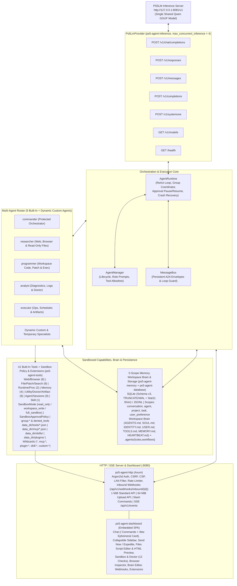

# PS5 Agent

**PS5 Agent** (`ps5-agent`) is a native Rust (`std` + Tokio + Axum + Reqwest/Rustls + SQLite/JSONL) autonomous multi-agent AI runtime and responsive web command center compiled to a userland PlayStation 5 ELF payload (`build/ps5-agent.elf`) for jailbroken **PlayStation 5 Slim** consoles running **Firmware `13.40`** (`0x13400000`).

Because PS5 payload processes run under `sys_budget_set(0)` (0 Direct Memory, shared Flexible Memory alongside system services and the inference server), PS5 Agent does **not** load its own LLM weights. Instead, all agents share a single loaded **Qwen GGUF** model served locally by [`PS5LM`](https://github.com/cobanov/PS5LM) at `http://127.0.0.1:8081/v1`, bounded via `max_concurrent_inference = 4` (auto-synced to `PS5LM` `total_slots` when `auto_sync_from_ps5lm = true`) in `Ps5LmProvider` and `AgentRuntime`.

- **Target Hardware & Firmware:** PlayStation 5 Slim (`x86_64-sie-ps5-std`, `znver2`), Firmware `13.40`
- **Payload Artifact:** `build/ps5-agent.elf` (deployed via `ps5-payload-dev/elfldr` on TCP `:9021`)
- **Web Dashboard & REST/SSE API:** `http://<PS5-IP>:8080` (`127.0.0.1:18080` in host local-dev)
- **License:** `GPL-3.0-or-later`

---

## Architecture



### Key Runtime Highlights

- **All 7 PS5LM Endpoints, KV Prefill & `llama.cpp` Sampling:** `Ps5LmProvider` supports `chat_completions` (`POST /v1/chat/completions`), `responses` (`POST /v1/responses`), `anthropic_messages` (`POST /v1/messages`), `completions` (`POST /v1/completions` with ChatML rendering), `system_one` (`POST /v1/systemone` single-pass probability evaluation), `GET /v1/models`, and `GET /health` (with `/v1/health` fallback). When `inference.auto_sync_from_ps5lm = true` (default `30s`, or manually via `POST /api/v1/inference/sync` / **Sync from PS5LM Now**), startup and background polling probe `/props`, `/slots`, `/v1/models`, and `/health` to auto-discover model, `n_ctx`, slots, vision, and thinking support. `inference.prefill_kv_cache = true` triggers background `n_predict = 0` (`cache_prompt = true`) prefill requests when idle, and `apply_llamacpp_sampling_fields()` exposes full `llama.cpp` parameters (`cache_prompt`, `top_k`, `top_p`, `min_p`, `dynatemp_*`, `typical_p`, `xtc_*`, `top_n_sigma`, `repeat_penalty`, `repeat_last_n`, `presence_penalty`, `frequency_penalty`, DRY `dry_*`, Mirostat `mirostat*`, `seed`, `ignore_eos`, `stop_sequences`, `n_keep`, `id_slot`, `samplers`, `grammar`, `reasoning_format`, `timings_per_token`, and `custom_extra_body_json`).
- **Thinking Modes, Chat Slash Commands & Queue Control:** Supports Thinking Mode levels (`off`, `low`, `medium`, `high`, `max`) mapped to `llama.cpp` `chat_template_kwargs.enable_thinking`, `reasoning_effort`, `reasoning_format`, and `reasoning_budget` (`0`, `512`, `2048`, `8192`, `-1`). Non-leading system messages fold into `messages[0]`, `<think>...</think>` and orphan `</think>` / `<seed:think>` blocks stream cleanly into the Thinking drawer without leaking draft code into final answers, and tool calls extract across OpenAI `tool_calls`, Qwen `<tool_call>` XML, and JSON fallbacks. Chat supports built-in slash commands via `POST /api/v1/conversations/{id}/command` and the `#chat-slash-btn` palette — `/btw <question>` (ephemeral side-question using read-only context with zero chat, task, or memory persistence), `/status`, `/context`, `/tools [agent]`, `/compact [keep_recent]`, `/think`, `/model`, `/sandbox`, `/doctor [fix]`, `/new`, and `/help` — plus `.agents/workflows/<name>.md` custom slash commands, `/agent <name>`, `@name`, **Send Now** (`immediate: true`), **Run Immediately** (`POST /api/v1/tasks/{id}/expedite`), and scoped cancel (`POST /api/v1/conversations/{id}/cancel`).
- **OpenClaw & Codex Sandbox Policy, Tool Groups & Per-Agent Overrides:** `SandboxMode` (`read_only`, `workspace_write`, `full_sandbox` [default]) and `SandboxApprovalPolicy` (`full_auto` [default in `AppConfig`], `on_request` [effective default when `security.require_approval_for_mutating = true`], `always_ask`, `never`) govern tool execution globally or per-agent (`denied_tools`, `sandbox_mode`, `tool_profile`). Canonical alias mapping (`canonical_tool_id`: e.g. `exec`/`shell`/`bash` -> `sandbox_exec`, `canvas` -> `write_artifact`, `patch` -> `apply_patch`, `grep` -> `grep_search`, `glob` -> `glob_files`) and `group:*` expansions (`group:fs`, `group:web`, `group:runtime`, `group:memory`, `group:sessions`, `group:automation`, `group:utility`, `group:openclaw`) work across agent allowlists and denylists.
- **Workspace Brain, `.agents/{rules,workflows}` & Heartbeat Runner:** Startup seeds OpenClaw-style workspace markdown files (`AGENTS.md`, `SOUL.md`, `IDENTITY.md`, `USER.md`, `TOOLS.md`, `MEMORY.md`, `HEARTBEAT.md`), `memory/YYYY-MM-DD.md` daily logs, `.agents/rules/*.md` (defaulting `ps5-sandbox.md`), and `.agents/workflows/*.md` (defaulting `daily-brief.md`). When `sandbox.inject_brain_files = true` (default `max_brain_context_chars = 4000`), `build_brain_prompt_section()` injects compact `<brain>` prompt context, and when `sandbox.heartbeat_interval_secs > 0`, `AgentRuntime::tick_heartbeat_if_due()` evaluates non-comment instructions in `HEARTBEAT.md` and schedules background checks.
- **Command Center, Sandbox & Doctor (12 Checks) & Inbound Webhooks:** The zero-CDN responsive SPA adds a **Sandbox & Doctor** tab (`#section-sandbox`) for live sandbox/network policy updates (`GET`/`PUT /api/v1/sandbox`), the **12-check System Doctor** (`GET /api/v1/doctor`, `POST /api/v1/doctor/fix`), **Stateful Browser Inspector** (`/api/v1/sandbox/browser/*`), **Workspace Brain & Workflows Editor** (`GET`/`PUT /api/v1/brain`), and **Inbound Webhooks** (`GET`/`POST /api/v1/webhooks`, `POST /api/v1/webhooks/inbound/{id}` authenticated via `X-Ps5-Webhook-Token` or `Authorization: Bearer <token>`), alongside the collapsible sidebar, conversation reordering (`sort_order`), **Show raw output**, `/retry`, `/regenerate`, `/continue`, `/fork`, `DELETE`, `64 MiB` uploads, automatic `[FILE_CREATED: ...]` / `[ARTIFACT_CREATED: ...]` script transport, inline **Files** editor + `<iframe sandbox="allow-scripts">` HTML preview, and **Extensions** (`<data_dir>/{mcp,skills,plugins,tools}` with uncapped custom tools).
- **PS5 ABI, FW `13.40` Release Build & Leak-Mitigated Storage:** `ps5-std-rt` bridges FreeBSD 12 Rust `std` syscalls to the PS5 FreeBSD 11 kernel, while `include/ps5_sqlite_shim.h` redirects C `stat`/`fstat`/`lstat` in `sqlite3.c` to `__ps5_*11`. The verified PS5 FW `13.40` release binary (`build/ps5-agent.elf`, `8,161,776` bytes) pairs with `build/meta.json`; on startup, `src/startup.rs` verifies `installed_release_stamp` (`verify_or_sync_meta_json()`) and automatically upgrades DB schema, built-in agents, tool specs, extensions, and legacy config (`system.elf_upgrade`). SQLite defaults to `TRUNCATE` mode (`wal_mode = false`) on PS5 to avoid `.db-shm` `mmap` restart failures, while periodic 600s pruning, bounded SSE (`32` max), and rate-limiter eviction bound long-running memory.
- **`0 = Unlimited` Configuration & 5-Scope Memory:** Key limits (`max_output_tokens`, `timeout_secs`, `max_body_bytes`, `upload_max_body_bytes`, `max_agents`, `max_active_tasks`, `max_queued_tasks`, `max_concurrent_inference`, `max_messages_per_task`, `max_reasoning_iterations`, `default_task_timeout_secs`, `rate_limit_per_minute`, `retention_days`, `max_rows_per_table`, `max_brain_context_chars`, `max_exec_output_bytes`, `exec_timeout_secs`) accept `0` for unlimited (see [docs/SETTINGS_REFERENCE.md](docs/SETTINGS_REFERENCE.md)). Memories span `conversation`, `agent`, `project`, `task`, and `user_preference` with hybrid scoring, rolling compaction (`rolling-summary-{conv_id}`), and bulk import/export (`POST /api/v1/memories/import`, `GET /api/v1/memories/export`, `limit=0`).

---

## Default Agents

`AgentManager::seed_defaults()` seeds 5 built-in agents with per-agent tool allowlists and memory boundaries, alongside **Dynamic Custom Agents** (`POST /api/v1/agents`) and runtime **Temporary Specialists** (`request_temporary_specialist`). All 5 defaults inherit workspace `sandbox_mode` (`None`) and `tool_profile` (`None`) with `denied_tools = []`, each configurable per agent via API or Dashboard:

| Agent ID | Role & Priority | Protected | Max Iterations / Timeout | Default Tool & Memory Scope |
|---|---|---|---|---|
| `commander` | Lead orchestrator (`Commander`, priority `100`) | Yes | `0` / `0` (unlimited) | Orchestration (`assign_agent_task`, `send_agent_message`, `query_agent_status`, `request_temporary_specialist`, `sessions_*`), workspace file/patch/search (`read_file`, `write_file`, `edit_file`, `apply_patch`, `create_directory`, `delete_file`, `list_files`, `grep_search`, `glob_files`), `sandbox_exec`, `process`, web & browser (`web_search`, `web_fetch`, `browser`, `http_get`, `fetch_website`, `json_api_request`, `extract_html_text`), `write_artifact`, `doctor`, `system_info`, `ps5_info`, schedules & utilities, full read/write/cross-read memory, `load_skill`, extensions (`mcp:*`, `plugin:*`, `custom:*`). |
| `researcher` | Web, browser & read-only files (`Researcher`, priority `70`) | No | `0` / `0` (unlimited) | Read-only web & browser (`web_search`, `web_fetch`, `browser`, `http_get`, `extract_html_text`, `json_api_request`), read-only workspace inspection (`read_file`, `list_files`, `grep_search`, `glob_files`), memory, `write_artifact`, JSON/time/text helpers, `load_skill`, extensions. **Excludes** `write_file`, `edit_file`, `apply_patch`, `delete_file`, `sandbox_exec`, and `http_post`. |
| `programmer` | Code, patch & workspace exec (`Programmer`, priority `70`) | No | `0` / `0` (unlimited) | Workspace engineering (`read_file`, `write_file`, `edit_file`, `apply_patch`, `create_directory`, `delete_file`, `list_files`, `grep_search`, `glob_files`, `sandbox_exec`, `process`), docs lookup (`web_search`, `web_fetch`, `http_get`), `write_artifact`, `calculator`, `json_parse_format`, memory, `load_skill`, extensions. |
| `analyst` | Diagnostics & root-cause analysis (`Analyst`, priority `65`) | No | `0` / `0` (unlimited) | Read-only workspace search (`read_file`, `list_files`, `grep_search`, `glob_files`), `sandbox_exec`, `web_search`/`web_fetch`, `system_info`, `ps5_info`, `doctor`, `write_artifact`, analytics utilities, memory, `load_skill`, extensions. **Excludes** `write_file`, `edit_file`, `apply_patch`, and `delete_file`. |
| `executor` | Operational mutations & scheduling (`Executor`, priority `60`) | No | `0` / `0` (unlimited) | Full workspace CRUD/patch/exec (`read_file`, `write_file`, `edit_file`, `apply_patch`, `create_directory`, `delete_file`, `list_files`, `grep_search`, `glob_files`, `sandbox_exec`, `process`), `browser`, web ops (`web_search`, `web_fetch`, `http_get`, `json_api_request`, `extract_html_text`), schedules (`schedule_*`), `system_info`, `ps5_info`, `doctor`, `write_artifact`, memory, helpers, `load_skill`, extensions. |
| *Custom / Temp* | Dynamic user-defined or runtime-spawned specialists | No | Configurable | Custom system prompt, per-agent `model_config.api_mode`, allowlists (including `group:*`), plus optional `denied_tools`, `sandbox_mode`, and `tool_profile` overrides (`allow_temporary_specialists = true` for temp agents). |

---

## Sandboxed Tools (41 Built-In), Custom Tools & Extensions

All **41 built-in tools** are defined in [`crates/ps5-agent-tools/src/specs.rs`](crates/ps5-agent-tools/src/specs.rs) across 7 categories (`8 + 9 + 2 + 4 + 8 + 9 + 1 = 41`), complemented by declarative custom tools in `<data_dir>/tools/*.json` (`template` / `http` / OpenAI tool import via `POST /api/v1/tools`), **Skills** (`<data_dir>/skills/`, `SKILL.md`), **MCP Servers** (`<data_dir>/mcp/<id>.json`, Streamable-HTTP JSON-RPC 2.0 `mcpServers`), and **Plugins** (`<data_dir>/plugins/`, `plugin.json`) matched via wildcards (`"*"`, `"mcp:*"`, `"plugin:*"`, `"skill:*"`, `"custom:*"`), canonical aliases (`canonical_tool_id`), and `group:*` shorthands (`expand_tool_group`).

> **Approval Column Key:** Under `SandboxApprovalPolicy`, built-in tools without `requires_approval` pause **only under `always_ask`** when `is_mutating = true`; tools with `requires_approval = true` (`http_post`, `delete_file`) pause under **`on_request`** and **`always_ask`**, are denied under **`never`**, and run automatically under **`full_auto`** (note: `config.ps5-slim-1340.toml` sets `require_approval_for_mutating = true`, promoting `full_auto` -> `on_request`). All mutating tools and file writes are blocked under `SandboxMode::ReadOnly`.

### Web & Browser Tools (8)

| Tool ID | Permission | Mutating | Approval Gate | Description |
|---|---|---|---|---|
| `http_get` | `WebRead` | No | No | SSRF-guarded HTTP/HTTPS `GET` request to an allowed domain. |
| `http_post` | `WebWrite` | Yes | `requires_approval = true` | SSRF-guarded HTTP/HTTPS `POST` request; blocked under `read_only` / `workspace_write`. |
| `fetch_website` | `WebRead` | No | No | Fetches a webpage with SSRF protection and extracts readable text wrapped in `<untrusted_web_content>`. |
| `extract_html_text` | `WebRead` | No | No | Strips scripts, styles, and tags from HTML and returns readable text wrapped in `<untrusted_web_content>`. |
| `json_api_request` | `WebRead` | No | No | SSRF-guarded JSON HTTP API request (`GET`, `HEAD`, `POST`, `PUT`, `PATCH`, `DELETE`); non-GET/HEAD blocked under `read_only` / `workspace_write`. |
| `web_search` | `WebRead` | No | No | Multi-provider search (`auto`, `duckduckgo`, `searxng`, `brave`, `tavily`) with SSRF guard and anti-bot `blocked_by_challenge` detection. |
| `web_fetch` | `WebRead` | No | No | Fetches pages as `markdown` or `text` with SSRF guard, `max_chars` bounding, and anti-bot `blocked_by_challenge` detection. |
| `browser` | `WebRead` | No | No | Stateful SSRF-guarded browser (`open`, `navigate`, `snapshot` `[ref=eN]`, `click`, `fill`, `submit`, `back`, `links`, `download`, `save_snapshot`, `sessions`, `close`) + optional `remote_browser_url`. `download`/`save_snapshot`/`submit` blocked under `read_only`. |

### File, Search & Patch Tools (9)

| Tool ID | Permission | Mutating | Approval Gate | Description |
|---|---|---|---|---|
| `list_files` | `FileRead` | No | No | Lists files and directories strictly inside `tools.allowed_paths` (`max_entries <= 2000`). |
| `read_file` | `FileRead` | No | No | Reads a UTF-8 text file strictly inside `tools.allowed_paths` (bounded by `max_file_bytes`). |
| `write_file` | `FileWrite` | Yes | Under `always_ask` | Writes or appends UTF-8 text to a file strictly inside `tools.allowed_paths`. |
| `create_directory` | `FileWrite` | Yes | Under `always_ask` | Creates a directory strictly inside `tools.allowed_paths`. |
| `delete_file` | `FileDelete` | Yes | `requires_approval = true` | Deletes a regular file strictly inside `tools.allowed_paths`. |
| `edit_file` | `FileWrite` | Yes | Under `always_ask` | Targeted string replacement inside an allowed workspace file. |
| `apply_patch` | `FileWrite` | Yes | Under `always_ask` | Applies unified/multi-file patches inside `tools.allowed_paths` without symlink escape. |
| `grep_search` | `FileRead` | No | No | Regex text search across workspace files (skipping `.git`, `target`, `node_modules`). |
| `glob_files` | `FileRead` | No | No | Glob pattern file discovery bounded within `tools.allowed_paths`. |

### Runtime & Process Tools (2)

| Tool ID | Permission | Mutating | Approval Gate | Description |
|---|---|---|---|---|
| `sandbox_exec` | `FileWrite`, `Utility` | Yes | Under `always_ask` | Default `engine="virtual"` executes a pure-Rust sandboxed shell (30 builtins: `pwd`, `ls`, `cat`, `head`, `tail`, `wc`, `grep`, `rg`, `find`, `mkdir`, `cp`, `mv`, `rm`, `sed`, `sha256sum`, `json`, `cd`, etc.; read commands work under `read_only`). `engine="host"` is compile-time disabled on PS5 (`target_vendor = "sie"`) and requires `allow_host_shell = true` + `full_sandbox` on host. |
| `process` | `Utility` | No | No | Lists, inspects, stops, or cancels running background tasks (`list`, `status`, `stop`, `cancel`). |

### Memory Tools (4)

| Tool ID | Permission | Mutating | Approval Gate | Description |
|---|---|---|---|---|
| `memory_read` | `Utility` | No | No | Queries persistent memories across `conversation`, `agent`, `project`, `task`, and `user_preference` scopes. |
| `memory_write` | `Utility` | Yes | Under `always_ask` | Persists a scoped key/value memory entry with importance weighting (`1..=10`). |
| `memory_search` | `FileRead`, `Utility` | No | No | Hybrid search across stored SQLite/JSONL memories and workspace brain/daily markdown files. |
| `memory_get` | `FileRead`, `Utility` | No | No | Reads a line-bounded excerpt (`from_line`, `lines`) from workspace memory markdown files. |

### Utility, Diagnostics & Artifact Tools (8)

| Tool ID | Permission | Mutating | Approval Gate | Description |
|---|---|---|---|---|
| `calculator` | `Utility` | No | No | Safely evaluates arithmetic expressions in pure Rust. |
| `datetime` | `Utility` | No | No | Returns current UTC time or parses, formats, adds seconds to, and diffs RFC 3339 timestamps. |
| `json_process` | `Utility` | No | No | Parses, validates, pretty-formats, minifies, inspects keys, or queries JSON pointers. |
| `text_process` | `Utility` | No | No | Inspects or transforms text (`length`, `word_count`, `trim`, `lowercase`, `uppercase`, `split`, `replace`, `truncate`, `regex_match`). |
| `system_info` | `Utility` | No | No | Reports OS/arch, active `sandbox_mode`, `approval_policy`, workspace root, and network flags. |
| `ps5_info` | `Utility` | No | No | Reports PS5 (`target_vendor = "sie"`) runtime posture, virtual/host shell status, and sandbox policy. |
| `doctor` | `Utility` | No | No | Runs the 12 diagnostic system checks (optional `fix: true` auto-fix; blocked under `read_only`). |
| `write_artifact` | `FileWrite` | Yes | Under `always_ask` | Alias `canvas`; saves HTML/SVG/Markdown/code artifacts inside the workspace and emits `[ARTIFACT_CREATED: ...]`. |

### Agent & Session Tools (9)

| Tool ID | Permission | Mutating | Approval Gate | Description |
|---|---|---|---|---|
| `send_agent_message` | `AgentComm` | No | No | Sends an agent-to-agent envelope through the persistent `MessageBus`. |
| `assign_agent_task` | `AgentDelegate` | No | No | Delegates a sub-task to another enabled agent (child tools enforce their own approval/sandbox checks). |
| `query_agent_status` | `AgentComm` | No | No | Queries runtime status of an agent or task. |
| `read_agent_memory` | `MemoryCrossRead` | No | No | Reads another agent's memories when `cross_agent_read` permission is granted. |
| `request_temporary_specialist` | `AgentSpawnTemp` | Yes | Under `always_ask` | Requests creation of a focused temporary specialist agent (`allow_temporary_specialists`). |
| `sessions_list` | `AgentComm` | No | No | Lists active/recent conversations and sub-agent sessions. |
| `sessions_spawn` | `AgentDelegate` | Yes | Under `always_ask` | Spawns an asynchronous session/sub-task on a target agent. |
| `sessions_send` | `AgentComm` | Yes | Under `always_ask` | Sends a follow-up message or prompt into an existing session/conversation. |
| `session_status` | `AgentComm` | No | No | Inspects status and recent activity of a conversation or task. |

### Skill Tools (1)

| Tool ID | Permission | Mutating | Approval Gate | Description |
|---|---|---|---|---|
| `load_skill` | `Utility` | No | No | Loads the full `SKILL.md` instructions and resource list for an available skill by ID or name. |

---

## Security Controls

| Control | Implementation Details |
|---|---|
| **Argon2id Authentication & Bootstrap** | First boot generates a 20-character alphanumeric (punctuation-free) CSPRNG (`OsRng`) password synced with the DB, written once to `<data_dir>/bootstrap_credentials.txt` (`0600` on Unix), and shown in a first-boot PS5 toast; only the PHC Argon2id hash (`m_cost = 8192 KiB` on PS5, `19456 KiB` on host, `t_cost = 2`, `p_cost = 1`) is stored. Login matches `admin_username` case-insensitively (`"admin"`) with constant-time verification, and supports `security.admin_password` in `config.toml` or toggling `auth_enabled` / `admin_username` in Dashboard Settings. |
| **Session Cookies, Bearer Tokens & Webhooks** | `POST /api/v1/auth/login` sets `HttpOnly; SameSite=Strict; Path=/` cookies backed by a 256-bit `OsRng` token stored only as its SHA-256 hex digest (`subtle::ConstantTimeEq`). Also supports `Authorization: Bearer <token>` hashed against `security.api_token_sha256`, and secret-authenticated inbound webhooks (`POST /api/v1/webhooks/inbound/{id}` via `X-Ps5-Webhook-Token` or `Authorization: Bearer <token>`). |
| **CSRF & Origin Validation** | Cookie-authenticated mutating requests (`POST`, `PUT`, `PATCH`, `DELETE`) require a matching `X-CSRF-Token` header (`subtle::ConstantTimeEq`). `Origin` / `Referer` headers on mutating requests and login must match the `Host` header (`403 Forbidden` otherwise). |
| **Strict CSP & Security Headers** | Applied to all responses: `Content-Security-Policy: default-src 'self'; script-src 'self'; style-src 'self'; img-src 'self' data:; connect-src 'self'; font-src 'self'; frame-src 'self' blob:; object-src 'none'; base-uri 'self'; frame-ancestors 'none'; form-action 'self'`, `X-Frame-Options: DENY` (`SAMEORIGIN` strictly on 2xx `/api/v1/files/preview`, embedded in `<iframe sandbox="allow-scripts">` without `allow-same-origin` to isolate generated HTML from dashboard cookies/CSRF), `X-Content-Type-Options: nosniff`, `Referrer-Policy: no-referrer`, and `Cache-Control: no-store` on `/api/*`. |
| **SSRF Guard & Anti-Bot Gate Detection** | `validate_web_url()` restricts schemes to `http`/`https`, rejects embedded credentials, enforces `blocked_domains` (overriding wildcards) and `allowed_domains`, disables HTTP redirects (`Policy::none()`), blocks `localhost`/`.local`/`.internal`, cloud metadata hosts/IPs, and private/loopback/link-local/CGNAT/multicast/IPv6 ULA ranges (pre- and post-DNS resolution unless `allow_local_network = true`), wraps fetched pages in `<untrusted_web_content>`, and surfaces CAPTCHA/Turnstile/anti-bot gates as `blocked_by_challenge: true` without bypassing them. |
| **Path & Symlink Sandbox** | File, patch, search, artifact, and workspace brain tools reject NUL bytes and `..` traversal components, block symlinks inside workspace hierarchies, canonicalize existing ancestors, and verify containment within `tools.allowed_paths` (default `/data/ps5-agent/workspace` on PS5) plus `tools.max_file_bytes` (`2 MiB`). |
| **Sandbox Policy & Human Approval Gates** | `SandboxMode` (`read_only`, `workspace_write`, `full_sandbox` [default]) and `SandboxApprovalPolicy` (`full_auto` / `on_request` / `always_ask` / `never`, with `require_approval_for_mutating = true` promoting `full_auto` -> `on_request`) enforce capability bounds and per-agent `denied_tools`. Tools requiring approval pause execution (`PausedExecutionState`) and return `409 Conflict` (`approval_required`) until resolved via `POST /api/v1/approvals/{id}/approve` or `deny`. |
| **LAN Filter, Rate Limiting & Body Cap** | `server.allow_lan_only = true` restricts access to RFC 1918, loopback, and IPv6 ULA peers; sliding-window per-IP rate limiting caps general (`240/min`, `0` = unlimited) and login (`10/min`) requests with `429` + `Retry-After`; standard API bodies default to `1 MiB` (`max_body_bytes`) and upload routes (`GET`/`POST /api/v1/conversations/{id}/messages`, `GET`/`POST /api/v1/tools`, `POST /api/v1/memories/import`, `POST /api/v1/files/upload`, `POST /api/v1/extensions/skills/import`, `POST /api/v1/extensions/plugins/import`, `POST /api/v1/extensions/mcp`) default to `64 MiB` (`upload_max_body_bytes`, `0` = unlimited). |
| **Sandboxed Virtual Shell & PS5 No-Exec Guard** | `sandbox_exec` defaults to a pure-Rust virtual workspace shell (`engine="virtual"`, 30 workspace-contained builtins with bounded output and timeouts). Host child-process spawning (`engine="host"`) is **compile-time removed on PS5** (`#[cfg(target_vendor = "sie")]`) and disabled on desktop hosts unless both `allow_host_shell = true` and `sandbox_mode = "full_sandbox"` are enabled. |

---

## Quickstart

### 1. Host Development & Testing

Run the local development server against `config/config.local-dev.toml` (binds `127.0.0.1:18080`, connects to `http://127.0.0.1:18081/v1`, stores data under `./data/ps5-agent`):

```bash
cargo run -- --config config/config.local-dev.toml
```

Run the workspace unit and integration test suite:

```bash
cargo test --workspace
```

> **Note (Windows):** If `cargo test` links native crates using MinGW/Clang, ensure your MinGW/LLVM `bin` directory is on `PATH` (see [docs/BUILDING.md](docs/BUILDING.md)).

### 2. PS5 Cross-Build & Deployment (Firmware `13.40`)

Prerequisites:
- Jailbroken PS5 Slim on Firmware `13.40` running [`ps5-payload-dev/elfldr`](https://github.com/ps5-payload-dev/elfldr) (`v0.27`, TCP `:9021`) and [`PS5LM`](https://github.com/cobanov/PS5LM) (`v0.11.0+`, `http://127.0.0.1:8081`) with a Qwen GGUF model loaded.
- Host toolchain: Rust `nightly` (`-Z build-std=std,panic_abort`), LLVM/Clang + `ld.lld` + `libclang`, and [`ps5-payload-dev/sdk`](https://github.com/ps5-payload-dev/sdk) (`v0.45`).

**Windows (PowerShell):**

```powershell
# Cross-compile, strip, and verify build/ps5-agent.elf (including SQLite Stat11 shim check)
powershell -ExecutionPolicy Bypass -File scripts/build-ps5.ps1 -Package ps5-agent

# Deploy build/ps5-agent.elf to elfldr on your PS5
powershell -ExecutionPolicy Bypass -File scripts/deploy-ps5.ps1 -TargetHost <PS5-IP> -Port 9021
```

**Linux / macOS / WSL:**

```bash
./scripts/build-ps5.sh ps5-agent
PS5_HOST=<PS5-IP> PS5_PORT=9021 ./scripts/deploy-ps5.sh build/ps5-agent.elf
```

Once running on the console:
1. Check `pldmgr` (Processes tab) where the payload appears as `ps5-agent.elf` (`8,161,776` bytes in `build/ps5-agent.elf`); it supports clean `SIGTERM` stop/restart with automatic `.pid` cleanup and reusable listener rebinding. On ELF updates, `installed_release_stamp` and `build/meta.json` (`verify_or_sync_meta_json`) automatically trigger schema/agent/tool/config upgrade checks while preserving user data.
2. Startup automatically ensures `<data_dir>/{mcp,skills,plugins,tools}` and `<data_dir>/workspace` (`AGENTS.md`, `SOUL.md`, `IDENTITY.md`, `USER.md`, `TOOLS.md`, `MEMORY.md`, `HEARTBEAT.md`, `.agents/{rules,workflows}`, `artifacts/`, `memory/`, `sandbox/`) exist, loading drop-in `<data_dir>/mcp/<id>.json` servers and `<data_dir>/tools/*.json` custom tools.
3. Read the one-time punctuation-free alphanumeric bootstrap password from `/data/ps5-agent/bootstrap_credentials.txt` (also shown in the first-boot PS5 toast and synced with the DB).
4. Open `http://<PS5-IP>:8080` from any browser on your LAN and sign in as `admin` (username matching is case-insensitive), then rotate the password or toggle `auth_enabled` / `admin_username` in Dashboard **Settings** (or via `POST /api/v1/auth/password`), and verify health in **Sandbox & Doctor** (or `/doctor` in Chat).
5. `config.toml` supports forgiving editing (UTF-8 BOM stripping, partial configs filled from defaults, optional `security.admin_password`, and automatic `.broken.bak` recovery on syntax errors). `config/config.ps5-slim-1340.toml` defaults `wal_mode = false` (SQLite rollback `TRUNCATE` mode) to prevent WAL `.db-shm` `mmap` restart failures.

---

## Documentation Index

| Document | Description |
|---|---|
| [docs/FEASIBILITY_REPORT_13_40.md](docs/FEASIBILITY_REPORT_13_40.md) | Firmware `13.40` SDK audit, FreeBSD 11/12 ABI compatibility, SQLite `Stat11` shim rationale, and verification matrix |
| [docs/ARCHITECTURE.md](docs/ARCHITECTURE.md) | Full workspace crate map (`13` workspace + `3` PS5 target crates), PS5LM provider, ReAct runtime, memory, and ABI layers |
| [docs/INSTALLATION.md](docs/INSTALLATION.md) | PS5 Slim FW `13.40` prerequisites, `/data/ps5-agent/` directory layout, deployment, and first-login setup |
| [docs/BUILDING.md](docs/BUILDING.md) | Nightly Rust + `ps5-payload-dev/sdk` toolchain setup, `x86_64-sie-ps5-std` flags, `elf-verify`, and host tests |
| [docs/DEBUGGING.md](docs/DEBUGGING.md) | `/dev/klog`, `elfldr` streaming, PS5 toasts, M1 hardware probe (`m1-ps5-probe.elf`), and rest-mode error `163` recovery |
| [docs/API.md](docs/API.md) | Complete REST (`/api/v1/*`) and SSE (`/api/v1/events`) endpoint reference, authentication, and error envelopes |
| [docs/DATABASE_SCHEMA.md](docs/DATABASE_SCHEMA.md) | SQLite WAL/TRUNCATE configuration, migration schema, and atomic JSONL fallback persistence |
| [docs/SECURITY.md](docs/SECURITY.md) | Threat model, Argon2id/cookie/CSRF auth, LAN-only filtering, rate limiting, and HTTP security headers |
| [docs/PERFORMANCE_REPORT.md](docs/PERFORMANCE_REPORT.md) | ELF binary sizes, memory footprint, host benchmark & test results, and hardware-pending PS5 status |
| [docs/SETTINGS_REFERENCE.md](docs/SETTINGS_REFERENCE.md) | Complete `config.toml` & Dashboard Settings reference, `0 = unlimited` limits, thinking modes, PS5LM sync, and retention pruning |
| [docs/KNOWN_LIMITATIONS.md](docs/KNOWN_LIMITATIONS.md) | GDDR6 Flexible Memory ceiling, sandbox execution boundaries, LAN HTTP, rest-mode/cold-reboot lifecycle, and hardware status |
