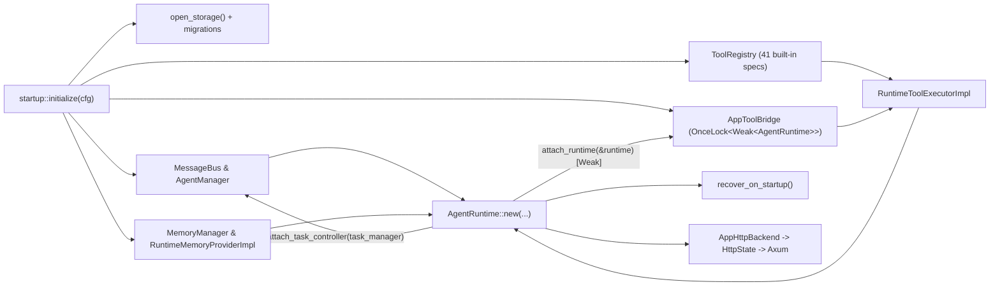
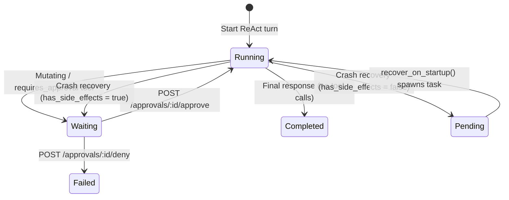
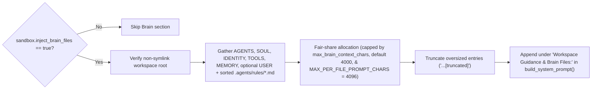
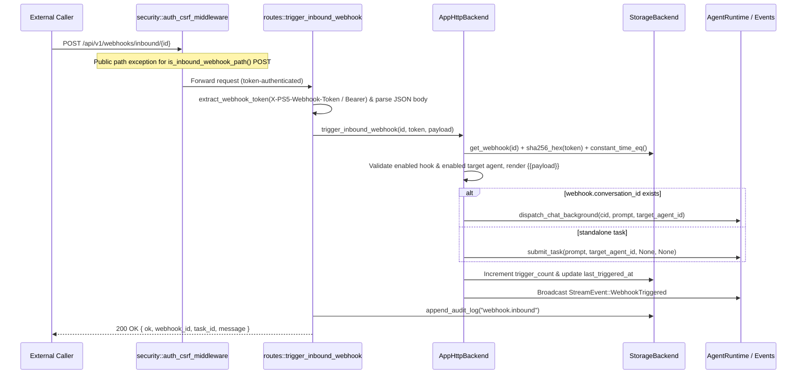

# PS5 Agent Architecture

`ps5-agent` is a multi-agent AI runtime, tool-sandbox, persistence engine, and embedded web command center targeting jailbroken PlayStation 5 consoles (Firmware `13.40`, `x86_64-sie-ps5-std`) alongside host development environments. It connects over localhost HTTP to `PS5LM`, serializing inference around a single loaded model while orchestrating specialized agents, A2A messaging, human-in-the-loop approvals, and hybrid memory.

---

## 1. Crate Map & Dependency Wiring

### 1.1 Workspace Crates (13 Members + Root Binary)

Defined in [`Cargo.toml`](../Cargo.toml):

| Crate | Path | Role & Key Dependencies |
|---|---|---|
| `ps5-agent` *(root binary)* | `src/` | Composition root, CLI parsing, `AppSystem` / `AppToolBridge` / `AppHttpBackend` adapters, startup recovery, graceful shutdown. Depends on all workspace crates + `ps5` / `ps5-std-rt` on `target_vendor = "sie"`. |
| `ps5-agent-core` | `crates/ps5-agent-core` | Shared domain models (`AgentDefinition` with `denied_tools`/`sandbox_mode`, `SandboxMode`, `SandboxApprovalPolicy`, `expand_tool_group`, `agent_allows_tool_with_policy`, `canonical_tool_id`, `TaskRecord`, `AgentEnvelope`, `MemoryItem`, `ToolSpec`, `ApprovalRecord`, `WebhookRecord`, `DoctorReport`, `RuntimeLimits`), `StorageBackend` & `InferenceProvider` traits, `StreamEvent`, `AgentError`. |
| `ps5-agent-config` | `crates/ps5-agent-config` | `AppConfig` resilient TOML loading (`sanitize_user_toml`, `#[serde(default)]`, `normalize_and_clamp`, `load_or_create_resilient` with `.toml.broken.bak`), `SandboxConfig` (`mode`, `approval_policy`, `allow_host_shell`, `remote_browser_url`, `inject_brain_files`, `max_brain_context_chars`, `heartbeat_interval_secs`), persistence, and PS5 `/data/ps5-agent` -> `/download0/ps5-agent` writable directory fallback (`resolve_writable_data_dir`). Depends on `ps5-agent-core`. |
| `ps5-agent-logging` | `crates/ps5-agent-logging` | `BrokenPipe`-safe `AppLogger`, bounded in-memory ring buffer, rotating `ps5-agent.log` sink, panic hook, and PS5 `klog` / toast bridge (`ps5` on `target_vendor = "sie"`). |
| `ps5-agent-database` | `crates/ps5-agent-database` | `StorageBackend` implementations (`SqliteStorage` with `NORMAL` locking and `TRUNCATE` mode on PS5 / WAL on host, corrupt DB `.corrupt.bak` auto-recovery + `JsonlStorage` fallback), schema migrations (`CURRENT_SCHEMA_VERSION = 3`, adding `conversations.sort_order`), `reorder_conversations`, retention pruning (`prune_old_records`, `purge_expired_sessions`), and lock-free `InstrumentedStorage` / `DbMetrics`. |
| `ps5-agent-memory` | `crates/ps5-agent-memory` | 5-scope `MemoryManager`, permission checks, per-agent retention cap, hybrid keyword/importance/recency scoring, and automatic conversation compaction (`rolling-summary-{conv_id}`). |
| `ps5-agent-inference` | `crates/ps5-agent-inference` | `Ps5LmProvider` (`InferenceProvider`), `max_concurrent_inference` semaphore (`0` -> `UNLIMITED_CONCURRENCY_PERMITS = 4096`), all 7 PS5LM endpoints + `discover_capabilities` (`/props`, `/slots`, `/v1/models`, `/health`), `prefill_kv_cache` (`n_predict: 0`), `apply_llamacpp_sampling_fields`, `ThinkingLevel` `llama.cpp` `reasoning_budget` controls, `fold_system_messages`, `ThinkStreamSplitter` / orphan `</think>` isolation, and 3-tier tool call parser. |
| `ps5-agent-tools` | `crates/ps5-agent-tools` | `ToolRegistry` (41 built-in sandboxed tools including `load_skill`/`read_skill`, stateful `browser` via `SandboxBrowserManager`, pure-Rust virtual & host-gated `sandbox_exec`, `apply_patch`), extensions (`SkillManager`, `McpManager` `<data_dir>/mcp/*.json` + Streamable-HTTP JSON-RPC 2.0 + fail-closed `readOnlyHint` classification, `PluginManager`, `CustomToolManager` `<data_dir>/tools/*.json` with no 20-tool cap), `SandboxMode`/`SandboxApprovalPolicy` gating, SSRF & path sandboxing, `AgentToolBridge`, and `ToolExecutionRecord` auditing. |
| `ps5-agent-messaging` | `crates/ps5-agent-messaging` | Persistent A2A `MessageBus`, 9 `AgentMessageType` variants, per-agent bounded `mpsc::Sender` inboxes (`AGENT_INBOX_CAPACITY = 256`), permission validation, and loop protection (`MAX_A2A_HOP_COUNT`, `max_messages_per_task`, ping-pong cap). |
| `ps5-agent-manager` | `crates/ps5-agent-manager` | `AgentManager` CRUD, seeding 5 default agents (`commander`, `researcher`, `programmer`, `analyst`, `executor`), temporary specialist lifecycle, and `AgentTaskController` hook. |
| `ps5-agent-runtime` | `crates/ps5-agent-runtime` | `AgentRuntime`, OpenClaw Workspace Brain loader/prompt injector (`brain.rs`), 5-second scheduler & `HEARTBEAT.md` runner (`tick_heartbeat_if_due`), slash commands (`/btw` ephemeral + `.agents/workflows/*.md` in `slash.rs`), 12-check `doctor.rs`, `TaskManager` (`release_token` cleaning `tokens` + `expedite_notifiers`), `dispatch_chat_background_with_options` (`immediate` queue bypass), `expedite_task`, `cancel_conversation_tasks`, root-only `task_semaphore`, `/agent` / `@mention` / natural specialist routing, `JoinSet` parallel group execution + synthesis, script auto-transport + `length`/`unclosed_code_fence` continuation, background KV prefill, approval pause/resume (`PausedExecutionState`), and `recover_on_startup()`. |
| `ps5-agent-dashboard` | `crates/ps5-agent-dashboard` | Zero-dependency embedded SPA assets (`INDEX_HTML`, `STYLES_CSS`, `APP_JS`) served offline over LAN: collapsible sidebar, drag/arrow conversation reordering, per-chat `activeChatTasks` task bar (`Run Immediately` / `Stop` / `Send Now`), and `Files` tab inline script viewer/editor. |
| `ps5-agent-http` | `crates/ps5-agent-http` | Axum REST/SSE API (`HttpState::effective_config()`, `HttpBackend`), split body limits (`standard_api_routes` vs `upload_api_routes`), conversation reorder/cancel/message retry-fork routes, `/conversations/{id}/command`, `/brain*`, `/sandbox*`, `/doctor*`, public token-hashed `/webhooks/inbound/{id}`, task expedite, memory import/export (`clamp_limit(Some(0)) -> 10_000`), workspace `/files/*` & sandboxed `/files/preview` CSP, `/extensions/*`, `/inference/*`, Argon2id auth & sessions, CSRF/Origin & LAN-only guards, `SlidingWindowRateLimiter` sweeping, `bind_reusable_listener`, and `RecoveringTcpListener`. |
| `mock-ps5lm` | `crates/mock-ps5lm` | Standalone & in-process mock PS5LM server supporting normal, scripted tool-call, multi-agent orchestration, slow-delay, 503, malformed-JSON, and incomplete-SSE test modes. |

### 1.2 Excluded PS5 Target Crates & Probe Binary

Excluded from the host workspace in `Cargo.toml` and built for `x86_64-sie-ps5-std` (or conditionally linked on `target_vendor = "sie"`):

| Crate / Binary | Path | Role |
|---|---|---|
| `ps5-sys` | `crates/ps5-sys` | Raw `bindgen` FFI bindings to `ps5-payload-sdk` (`wrapper.h` + `sce_extra.h`), feature-gated per Sony library (`kernel-sys`, `notification`, `random`, `user-service`, `system-service`, `app-inst-util`, `ssl`, `http2`). |
| `ps5` | `crates/ps5` | Safe `#![no_std]` wrappers over `ps5-sys` (`klog`, `notify::Toast`, `hw` telemetry, `payload::exit`, `net`, `http`, `app`, `system`, `random`). |
| `ps5-std-rt` | `crates/ps5-std-rt` | FreeBSD 11/12 ABI & syscall shim crate letting Rust's FreeBSD `std` link and run cleanly as a PS5 payload. |
| `m1-ps5-probe` | `bins/m1-ps5-probe` | Milestone 1 standalone PS5 hardware/runtime verification payload (`std`, panic hook, `ps5` HW/toast, filesystem check, Tokio TCP server on `:9957`). |

### 1.3 Startup Sequence & Cycle-Breaking Wiring (`AppToolBridge`)

Because `ToolRegistry` executes agent-to-agent tools (`assign_agent_task`, `send_agent_message`, `query_agent_status`, `read_agent_memory`, `request_temporary_specialist`) that delegate back into `AgentRuntime` and `TaskManager`, a direct strong `Arc<AgentRuntime>` inside the tool layer would form a reference cycle (`AgentRuntime -> RuntimeToolExecutorImpl -> AppToolBridge -> AgentRuntime`).

`src/startup.rs` and `src/adapters.rs` break both runtime cycles using trait inversion + weak late-binding:



1. **Process naming, signal setup & Tokio sizing (`src/main.rs`)**:
   - On PS5 (`target_vendor = "sie"`), `main()` immediately calls `ps5::payload::set_process_name("ps5-agent.elf")` (invoking FreeBSD `SYS_thr_set_name` / `464` with a 19-byte `MAXCOMLEN` null-terminated buffer, matching `"m1-ps5-probe.elf"` in `bins/m1-ps5-probe`) so `pldmgr` displays the real ELF name instead of `payload.elf`, and ignores `SIGPIPE` and `SIGHUP` (`libc::signal(..., SIG_IGN)`).
   - Early startup failures invoke `report_fatal_startup_error`, appending diagnostics to `<data_dir>/startup_error.log` (via `resolve_writable_data_dir`) plus `klog` and a `"PS5 Agent Startup Error"` toast on PS5.
   - `worker_thread_count` clamps Tokio worker threads to `1..=3` on PS5 (`target_vendor = "sie"`) and `1..=8` on host.
2. **Resilient configuration & live `HttpState::effective_config()` (`crates/ps5-agent-config`, `crates/ps5-agent-http`, `src/adapters.rs`)**:
   - `load_effective_config_with_warnings` calls `AppConfig::load_or_create_resilient`, which runs `sanitize_user_toml` (stripping UTF-8 BOM `\u{feff}` / NUL bytes and normalizing boolean variants like `True`/`yes`/`on` or quoted `"true"`/`"false"`), parses partial TOML via `#[serde(default)]` across `AppConfig` and all 9 sub-structs (with aliases such as `auth`, `username`, `host`, `url`, and `password` -> `admin_password`), and normalizes/clamps bounded fields via `normalize_and_clamp` (`context_limit`, `max_output_tokens`, `max_body_bytes`, `upload_max_body_bytes`, `tokio_worker_threads`, plus `thinking_level`, `driver`, `on_disable_policy`, and `allowed_paths`, while permitting `0 = unlimited` across capacity/concurrency/retention limits such as `max_agents`, `max_active_tasks`, and `max_concurrent_inference`). Unrecoverable syntax or validation errors back up the broken file to `config.toml.broken.bak` and boot with safe defaults + warnings.
   - `HttpState::effective_config()` queries `HttpBackend::current_config()` dynamically so `PUT /api/v1/settings` updates—including `security` settings (`auth_enabled`, `admin_username`, `require_approval_for_mutating`, `session_ttl_hours`) persisted by `AppHttpBackend::apply_settings_update`—apply immediately across `security_network_middleware`, auth handlers, and `serve`.
3. **Core services, PID singleton, Workspace Brain seeding & SQLite recovery (`src/startup.rs`, `crates/ps5-agent-database`, `crates/ps5-agent-http/src/auth.rs`)**:
   - Installs `rustls::crypto::ring`, creates directories, initializes `AppLogger` + panic hook (logging config warnings and showing a toast if `.broken.bak` recovery occurred), runs `manage_pid_file(<data_dir>/ps5-agent.pid)`: if an existing PID belongs to `"ps5-agent.elf"` or `"payload.elf"` (verified via `sysctl` `CTL_KERN/KERN_PROC/KERN_PROC_PID` on FreeBSD or `/proc/<pid>/comm` on other Unix), sends `SIGTERM` (polling up to 600 ms in 50 ms steps) then `SIGKILL` before recording the current PID, and seeds the primary workspace's OpenClaw Brain layout via `ps5_agent_runtime::brain::seed_workspace_brain_files(&brain_workspace_root)`.
   - Opens `StorageBackend` via `open_storage`: `SqliteStorage::configure_pragmas` sets `PRAGMA locking_mode = NORMAL;` and enforces `effective_wal = cfg.wal_mode && !cfg!(target_vendor = "sie")` so PS5 always uses `PRAGMA journal_mode = TRUNCATE` (avoiding `.db-shm` `mmap(MAP_SHARED)` hazards on `/data`, cleaning up stale `-shm` sidecars when `-wal` is absent/empty). In `"auto"` mode, `try_open_sqlite_checked` runs `run_migrations()` and `integrity_check()` (`"ok"`); if an existing DB file fails, it backs it up to `<path>.corrupt.bak`, clears stale sidecars, and retries fresh SQLite initialization before falling back to `JsonlStorage`.
   - Creates `broadcast::channel::<StreamEvent>(512)`, `MessageBus`, `AgentManager` (seeding 5 default agents), `MemoryManager`, `ToolRegistry::with_data_dir(store, cfg.tools, &cfg.data_dir)` (creating/scanning `<data_dir>/{mcp,skills,plugins,tools}` for built-in tools, `SandboxBrowserManager`, `SkillManager`, `McpManager`, `PluginManager`, and `CustomToolManager`, followed by `sync_plugin_mcp_configs(&tools, &logger)`), and `Ps5LmProvider`.
   - Runs `store.prune_old_records(cfg.database.retention_days, cfg.database.max_rows_per_table)` on startup, and `ensure_bootstrap_credentials_with_report` synchronizes `cfg.security.admin_password` / `password_hash`, `settings["auth.password_hash"]`, and `bootstrap_credentials.txt` (using an unambiguous alphanumeric alphabet, case-insensitive `admin_username` matching, and self-healing from unrotated `bootstrap_credentials.txt`).
4. **Weak bridge wiring (`src/adapters.rs`)**:
   - `AppToolBridge` is constructed first with `Arc<AgentManager>`, `Arc<MessageBus>`, `Arc<MemoryManager>`, and empty `OnceLock<Weak<AgentRuntime>>` / `OnceLock<Arc<TaskManager>>` / `OnceLock<Arc<SandboxBrowserManager>>` slots.
   - `RuntimeToolExecutorImpl` wraps `ToolRegistry` and `AppToolBridge` and is passed into `AgentRuntime::new(...)`; `tool_bridge.attach_browser_manager(tools.browser().clone())` wires stateful HTTP browser controls (`GET/POST/DELETE /api/v1/sandbox/browser/*`).
   - Inside `AgentRuntime::new(...)`, `agent_manager.attach_task_controller(task_manager.clone())` registers the `AgentTaskController` trait hook without giving `ps5-agent-manager` a compile-time dependency on `ps5-agent-runtime`.
   - Immediately after `AgentRuntime::new`, `tool_bridge.attach_runtime(&runtime)` stores `Arc::downgrade(runtime)` in `AppToolBridge::runtime`. At invocation time, `AppToolBridge::require_runtime()` upgrades the `Weak` reference, avoiding reference cycles and failing cleanly during shutdown.
5. **Recovery, capability sync, scheduler/heartbeat & maintenance loops, HTTP binding & daemon shutdown (`src/startup.rs`, `src/shutdown.rs`, `crates/ps5-agent-http/src/server.rs`)**:
   - Calls `runtime.recover_on_startup().await?` and initializes `AppHttpBackend` (carrying `ps5lm_capabilities` and `auto_synced_slots`). When `cfg.inference.auto_sync_from_ps5lm` is enabled, runs `http_backend.sync_ps5lm_capabilities().await` on startup; otherwise probes `refresh_ps5lm_health().await`.
   - Spawns three background loops: (1) a PS5LM health & capability auto-sync poller (`health_poll_interval_secs.max(5)`s) calling `sync_ps5lm_capabilities()` whenever `auto_sync_interval_secs` (default `30`s) has elapsed, (2) a `600`-second periodic storage maintenance loop executing `prune_old_records`, `purge_expired_sessions(&now_iso())`, and `checkpoint()`, and (3) a `5`-second autonomous scheduler loop calling `tick_due_schedules(...)` and `tick_heartbeat_if_due()` (polling `HEARTBEAT.md` when `sandbox.heartbeat_interval_secs > 0`).
   - Constructs `HttpState` with `ps5_agent_dashboard` embedded assets and (on PS5 when `enable_toast = true`) emits a startup toast showing generated first-boot credentials if present.
   - `bind_reusable_listener` configures `SO_REUSEADDR` and (`#[cfg(unix)]`) `SO_REUSEPORT` on the `TcpSocket` (`listen(1024)`) so rapid daemon restarts rebind immediately.
   - `spawn_signal_handler` installs an atomic `TERM_SIGNAL_RECEIVED` handler for `SIGTERM` / `SIGINT` on PS5 (polled every 250 ms in `src/shutdown.rs`) alongside `tokio::signal::ctrl_c()` on host; `finalize_shutdown` cancels active non-waiting tasks, checkpoints SQLite, flushes logs, and removes `<data_dir>/ps5-agent.pid` (`cleanup_pid_file`).

---

## 2. Single-Model Shared Inference Architecture

### 2.1 Concurrency Serialization (`max_concurrent_inference`)

PS5LM hosts a single loaded GGUF model in the console's shared memory. Concurrent generation requests would thrash KV-cache state or exhaust memory unless PS5LM is configured with multiple slots (`total_slots`). `ps5-agent` enforces `max_concurrent_inference` (`AppConfig::with_data_dir` and `config/config.ps5-slim-1340.toml` both default to `4`, auto-synced to PS5LM `total_slots` when `auto_sync_from_ps5lm = true`; setting `0` maps to `UNLIMITED_CONCURRENCY_PERMITS = 4096`) at **two layers**:

- **`AgentRuntime::inference_semaphore`** (`crates/ps5-agent-runtime/src/runtime.rs`): Acquired around every `run_inference_call` and `coordinate_group_participants` call so multiple active tasks (`max_active_tasks`, `0` unlimited in both `AppConfig::with_data_dir` and `config/config.ps5-slim-1340.toml`) interleave reasoning and tool execution without overlapping LLM requests beyond the configured slot budget.
- **`Ps5LmProvider::semaphore`** (`crates/ps5-agent-inference/src/provider.rs`): Acquired via `acquire_permit` (cancellable via `tokio::select!` on `CancellationToken`) inside `generate()`, `generate_stream()`, and `system_one()`, and dynamically reconfigurable via `set_max_concurrent`.

All agents share the single PS5LM instance and default model (`cfg.inference.model`, optionally overridden by `agent.model_config.model_override`), while differentiating persona, tool allowlists, memory permissions, temperature, token limits (`max_output_tokens == 0` omits `max_tokens`/`max_output_tokens`), `api_mode`, and `ThinkingLevel`:
- On `ApiMode::ChatCompletions` (`llama.cpp` / PS5LM): `Off` sets `chat_template_kwargs: {"enable_thinking": false}`, `reasoning_budget: 0`, and `reasoning_format: "none"`; `Low`/`Medium`/`High`/`Max` set `enable_thinking: true` with `reasoning_effort` (`"low"`/`"medium"`/`"high"`/`"high"`) and `reasoning_budget` (`512`/`2048`/`8192`/`-1`).
- On `ApiMode::AnthropicMessages`, non-`Off` levels map to thinking budgets `1024` (`Low`), `4096` (`Medium`), `8192` (`High`), and `16384` (`Max`).

### 2.2 PS5LM Endpoints (All 7 Endpoints)

`Ps5LmProvider` (`crates/ps5-agent-inference/src/provider.rs`) targets `base_url` (normalized into `root_url` and `v1_url`):

| Endpoint | Method | `ApiMode` / Caller | Request / Response Behavior |
|---|---|---|---|
| `/v1/chat/completions` | `POST` | `ApiMode::ChatCompletions` | OpenAI-compatible `messages` + `tools` (`type: "function"`), Bearer auth, streaming SSE (`choices[0].delta.{content,reasoning_content,tool_calls}`) terminated by `data: [DONE]`. |
| `/v1/responses` | `POST` | `ApiMode::Responses` | OpenAI Responses format: extracts `messages[0]` (`system`) into top-level `instructions`, maps assistant tool calls to `function_call` items and tool outputs to `function_call_output`, parses `response.output_text.delta` / `response.reasoning.delta` / `response.completed`. |
| `/v1/messages` | `POST` | `ApiMode::AnthropicMessages` | Anthropic Messages format with `anthropic-version: 2023-06-01` and `x-api-key` header; extracts `messages[0]` into top-level `system`, maps `tool_calls` to `tool_use` and tool results to `tool_result` user blocks, handles `content_block_start`/`content_block_delta`/`message_delta`/`message_stop`. |
| `/v1/completions` | `POST` | `ApiMode::Completions` | Legacy completions endpoint driven by a built-in **ChatML renderer** (`<\|im_start\|>{role}\n{content}<\|im_end\|>\n...<\|im_start\|>assistant\n`, `stop: ["<\|im_end\|>"]`). Injects tool schemas and `<tool_call>` instructions into `messages[0]` when `role == "system"` and `tools` is non-empty. |
| `/v1/systemone` | `POST` | `ApiMode::SystemOne` | PS5LM single-pass probability evaluator (`{model, state, questions}`). Passes structured `state` + `questions` (`choice`, `noul`, `score` criteria) directly or synthesizes them from messages/tools; always executes non-streaming (emitting `TextDelta` + `Completed` if called via `generate_stream`). |
| `/v1/models` | `GET` | `list_models()` / `health_check()` | Enumerates loaded/available models from `data[].id` or `models[]`. |
| `/health` | `GET` | `health_check()` | Probes PS5LM liveness and `loaded_model` (combined with `/v1/models` in `ProviderHealth`). |

Pre-response TCP connection failures (`err.is_connect()`) undergo bounded exponential backoff (`min(100 * 2^attempt, 2000)` ms up to `cfg.max_retries`); HTTP `503` maps to `AgentError::InferenceUnavailable`.

### 2.3 Qwen & Seed Compatibility: System Folding, `<think>` / Orphan `</think>` Isolation & 3-Tier Tool Extraction

Implemented in `crates/ps5-agent-inference/src/parser.rs`:

1. **Leading system message folding (`fold_system_messages`)**:
   - Collects all messages whose role is `"system"` or `"developer"` (case-insensitive), joins non-empty contents with `"\n\n"`, and places them into a single leading `messages[0]` (`role = "system"`), preserving the relative order of all non-system messages. This prevents Qwen chat templates from rejecting mid-conversation system turns.
2. **Incremental `<think>...</think>` & orphan `</think>` streaming splitter (`ThinkStreamSplitter`)**:
   - Processes each SSE text delta as a state machine (`in_think`, `emitted_any_text`, `closed_any_think`, `pending`), matching both `<think>`/`</think>` and `<seed:think>`/`</seed:think>` (`THINK_OPEN_TAGS` / `THINK_CLOSE_TAGS`) case-insensitively and emitting `StreamPiece::Reasoning` inside think blocks vs `StreamPiece::Text` outside.
   - **Orphan closing tag isolation**: When PS5LM's prompt template prefills `<think>` outside the sampled completion, the response starts directly inside reasoning and hits a closing `</think>` (or `</seed:think>`) with no prior opening tag. When `!emitted_any_text && !closed_any_think`, `ThinkStreamSplitter` routes everything preceding that first closing tag to `StreamPiece::Reasoning`, sets `closed_any_think = true`, and routes post-tag content to `StreamPiece::Text`—while ignoring any later literal `</think>` once text has begun so visible output cannot be pulled backward into reasoning.
   - `max_partial_tag_suffix_len` holds back any trailing substring that could be a split tag across SSE chunks (e.g., `"<thi"` followed by `"nk>"`). On stream completion, `finish()` flushes remaining buffered bytes. Downstream in `AgentRuntime`, text/reasoning deltas become `StreamEvent::ChatToken` / `StreamEvent::ChatReasoning`, and `emit_chat_completed` attaches final `reasoning: msg.reasoning.clone()` onto `StreamEvent::ChatCompleted`.
3. **3-tier tool call extraction (`parse_model_output`)**:
   - Calls `extract_think_blocks`, which strips `<think>...</think>` / `<seed:think>...</seed:think>` (and isolates leading orphan text before a closing tag at `cursor == 0 && cleaned.is_empty()`) into `reasoning`—keeping draft thinking/code out of `msg.content`—while preserving unclosed `<think>` literals and merging with API-native `reasoning_content` / `thinking`.
   - **Tier 1 — Native API `tool_calls`**: If the endpoint returned structured `tool_calls` (`ChatCompletions` `tool_calls`, `Responses` `function_call`, or `AnthropicMessages` `tool_use`), uses them directly.
   - **Tier 2 — Qwen `<tool_call>` XML**: Scans for `<tool_call>...</tool_call>` blocks (stripping optional markdown code fences), parses JSON `{"name": ..., "arguments": ...}`, and removes the XML tags from visible `content`.
   - **Tier 3 — Structured JSON fallback**: If the remaining output is a JSON object (optionally code-fenced) containing `"tool_calls"` (array) or `"final_answer"`, extracts `thought`, `tool_calls`, and `final_answer`. Arbitrary JSON lacking both keys is left untouched as normal assistant text.

### 2.4 Automatic PS5LM Capability Discovery (`/props`, `/slots`, `/v1/models`, `/health`)

`Ps5LmProvider::discover_capabilities()` (`crates/ps5-agent-inference/src/provider.rs`) probes `GET /health`, `GET /v1/models`, `GET /props`, and `GET /slots` concurrently via `tokio::join!` (using `connect_timeout_secs.max(3)`), assembling a `Ps5LmCapabilities` snapshot (`base_url`, `healthy`, `loaded_model`, `available_models`, `context_length`, `total_slots`, `supports_vision`, `supports_thinking`, `synced_at`):

- `apply_props_json` and `apply_slots_json` extract context length, loaded model, vision/thinking capabilities, and `total_slots` (falling back to slot array length or `/v1/models` context metadata), augmented by `infer_model_hints` on discovered model names.
- `AppHttpBackend::sync_ps5lm_capabilities_with_notify()` (`src/adapters.rs`) applies discovered context (`apply_discovered_context`) and—when `cfg.inference.auto_sync_from_ps5lm` is true (default, synced on startup and every `auto_sync_interval_secs = 30`s)—updates `cfg.inference.model` and `cfg.inference.context_limit`. If `cfg.agents.max_concurrent_inference` is `0`, `4`, or matches `auto_synced_slots`, it rescales concurrency to `total_slots` and updates `Ps5LmProvider::set_max_concurrent`.
- Emits `StreamEvent::Ps5LmSynced` over SSE and exposes capabilities/manual sync via `GET /api/v1/inference/capabilities` and `POST /api/v1/inference/sync`.

### 2.5 KV Cache Prefill & `llama.cpp` Sampling Parameters

- **Background KV Cache Prefill (`spawn_kv_cache_prefill` / `Ps5LmProvider::prefill_kv_cache`)**:
  - After a chat turn or assistant continuation completes (`cfg.inference.prefill_kv_cache = true`), `AgentRuntime` spawns a best-effort background task that non-blockingly checks `inference_semaphore.try_acquire_owned()` (skipping silently if PS5LM is already busy).
  - `build_prefill_messages` gathers the agent system prompt + memory context and active conversation history (`keep_recent_messages.max(100)`), and `Ps5LmProvider::prefill_kv_cache` fires a `POST /v1/chat/completions` request with `stream: false`, `cache_prompt: true`, `max_tokens: 0`, `n_predict: 0`, and `chat_template_kwargs: {"enable_thinking": false}` (`30s` timeout) so the prompt + reply prefix is warmed in PS5LM's KV cache before the user's next turn.
- **`llama.cpp` Sampling & Prompt Controls (`apply_llamacpp_sampling_fields`)**:
  - Applied across `/v1/chat/completions`, `/v1/responses`, and `/v1/completions` payloads: always sends `cache_prompt`, `top_k`, `top_p`, `min_p`, `repeat_penalty`, `repeat_last_n`, `presence_penalty`, `frequency_penalty`.
  - Conditionally forwards active parameters: `dynatemp_range`/`dynatemp_exponent` (`> 0.0`), `typical_p` (`< 1.0`), `xtc_probability`/`xtc_threshold` (`> 0.0`), `top_n_sigma` (`> 0.0`), DRY repetition penalty (`dry_multiplier > 0.0` + `dry_base`, `dry_allowed_length`, `dry_penalty_last_n`), `mirostat` (`> 0` + `mirostat_tau`, `mirostat_eta`), `seed` (`!= -1`), `ignore_eos`, `n_keep` (`!= 0`), `id_slot` (`>= 0`), `samplers`, `grammar`, `timings_per_token` (explicitly exempt from `is_sensitive_setting_key` redaction in `routes.rs`), deduplicated `stop` sequences, `reasoning_format` (when `thinking_level != Off`), and top-level `custom_extra_body_json` entries (protected against overwriting `messages`, `input`, `prompt`, or `stream`).

---

## 3. Multi-Agent Execution, A2A Messaging & Crash Recovery

### 3.1 Concurrent Chat Dispatch, Expedite Queue, Routing, Group `JoinSet`, Script Auto-Transport & ReAct Loop

`AgentRuntime` (`crates/ps5-agent-runtime/src/runtime.rs`) orchestrates synchronous turns, concurrent background chat (`async_dispatch: true` or `immediate: true` -> `dispatch_chat_background_with_options`), and child agent tasks:

- **Concurrent Background Chat, Queue Bypass (`immediate` / `expedite_task`), & Root-Only `task_semaphore`**:
  - `dispatch_chat_background_with_options` resolves the target, persists the user `ChatMessage`, creates a `Pending` root `TaskRecord`, registers both a `CancellationToken` and an expedite `Arc<Notify>` (`TaskManager::register_expedite`), and returns `(ChatMessage, TaskRecord)` immediately.
  - On the spawned task, `await_task_slot_or_expedite` checks `immediate`: if `true` (`#chat-send-immediate-btn` "Send Now"), it bypasses `task_semaphore` immediately; if `false`, it runs a biased `tokio::select!` across `cancel.cancelled()`, `expedite.notified()`, and `task_sem.acquire_owned()` (guarded afterwards by `cancel.is_cancelled()` so cancelled pending tasks never start). Calling `POST /api/v1/tasks/{id}/expedite` (`expedite_task`, wired to **Run Immediately** in the per-chat task bar) persists `"Expedited — starting immediately"` and notifies the waiting task to jump the queue.
  - **Root-only permit acquisition**: Only root tasks (`task.parent_task_id.is_none()`) acquire `task_semaphore` (`max_active_tasks`, `0` -> `UNLIMITED_SEMAPHORE_PERMITS = 4096` in both `AppConfig::with_data_dir` and `config/config.ps5-slim-1340.toml`); child tasks spawned by an active parent (e.g., via `assign_agent_task` or Group Chat) run under the parent's slot so multi-agent fan-out cannot self-deadlock.
  - **Per-conversation scoped cancellation**: `POST /api/v1/conversations/{id}/cancel` invokes `TaskManager::cancel_conversation_tasks(conv_id, agent_id, reason)`, cancelling all non-terminal tasks for a specific conversation (or one agent within it) without affecting sibling conversations. `StreamEvent::TaskUpdated` carries `conversation_id: Option<String>` so the dashboard scopes its active task bar (`state.activeChatTasks`) per conversation.
- **`/agent`, `@mention`, & Natural Specialist Routing (`resolve_dispatch_target`)**:
  - Dispatch target resolution checks, in priority order: (1) explicit `target_agent_id` (`format_explicit_agent_prompt`), (2) `resolve_agent_routing` via `strip_leading_agent_prefix` + `match_agent_token`, and (3) the conversation's `ConversationMode`.
  - `strip_leading_agent_prefix` matches `/agent <target>`, `@<target>`, and natural lead-ins (`"ask the "`, `"tell the "`, `"ask "`, `"tell "`, `"have "`, `"let "`, optionally followed by `"to "`). `match_agent_token` resolves enabled agents case-insensitively across `id`, `name` (exact or with spaces normalized to `-`/`_`), `role`, or `role_label`, wrapping non-Commander prompts with `format_direct_specialist_prompt`.
- **ReAct Loop, Progress Labels, Auto-Continuation & Script Auto-Transport (`execute_react_loop` / `continue_react_loop`)**:
  1. Builds memory context via `RuntimeMemoryProvider::build_context_for_agent` and constructs the system prompt (`build_system_prompt`): persona, identity, UTC time, `Workspace Guidance & Brain Files` (`build_brain_prompt_section` when `sandbox.inject_brain_files` is enabled; Section 8), enabled peer roster (`can_communicate`), available skills (`load_skill`) & `Active Plugin Guidelines`, and `[Memory Context]`. (Read-only slash commands such as `/btw` and ephemeral `.agents/workflows/*.md` bypass this persistent ReAct loop via `POST /api/v1/conversations/{id}/command`; Section 9.)
  2. Loads recent active conversation history (`keep_recent_messages.max(4)`) and appends the user request (plus image data URLs for multimodal attachments).
  3. Loops up to `min(agent.max_reasoning_iterations, cfg.agents.max_reasoning_iterations)` iterations (capped at `UNLIMITED_REASONING_SAFETY_CAP = 256` when unlimited): at `iter == 0`, emits thinking progress labels via `format_thinking_start_note` (`"Generating response…"` for `Off`, `"Thinking (low)…"`, `"Thinking (medium)…"`, `"Thinking (high)…"`, `"Thinking (max)…"`), and at `iter >= 1` emits `"Tool call step {iter}/{limit}"` (or `"Tool call step {iter}"` when unlimited). Executes inference with `allowed_tool_schemas`; if `tool_calls` is non-empty, runs `execute_tool_batch`, appends `role = "tool"` observations, and continues.
  4. **Auto-continuation (`length` or `unclosed_code_fence`)**: When `tool_calls` is empty and either `resp.finish_reason.as_deref() == Some("length")` or `has_unclosed_code_fence(&cumulative_preview)` is true (up to `MAX_AUTO_CONTINUATIONS = 4`), appends the partial segment to `continuation_parts`, pushes a seamless continuation prompt, emits `StreamEvent::ContinuationTriggered` (`reason: "length"` or `"unclosed_code_fence"`), and continues; `join_continuation_parts` stitches the segments.
  5. **Script Auto-Transport & Duplicate Cleanup**: When `!did_write_file`, `extract_all_fenced_script_blocks(&final_content, 10)` extracts fenced code blocks of `>= 10` lines, writes each to the workspace using the agent's enabled write tool with approval bypass (`approved_bypass = true`), marks `has_side_effects`, emits `StreamEvent::FilesChanged`, and replaces each raw fenced block in `final_content` with ``Created `{filename}` ({lines} lines) and transported it to the Files tab.\n[FILE_CREATED: {filename}]``. When `did_write_file` is true, any remaining `>= 15`-line duplicate fenced blocks in `final_content` are replaced with `"Created \`{wrote_path}\` and transported it to the Files tab."` plus `[FILE_CREATED: {wrote_path}]`. Finally persists the assistant `ChatMessage`, emits `StreamEvent::ChatCompleted { ..., reasoning }`, triggers background `spawn_kv_cache_prefill`, and completes the task.
- **Direct Chat (`ConversationMode::Direct { agent_id }`)**: Routes the turn directly to `agent_id` (e.g., `"commander"`).
- **Group Chat (`ConversationMode::Group { participant_agent_ids }`)**:
  1. `run_group_chat_with_task` assigns the parent task to `commander` and calls `coordinate_group_participants`.
  2. Commander inspects each candidate participant's `id`, `name`, `role_label`, `description`, and `enabled_tools`, returning a `GroupCoordinatorDecision { selected_agents: Vec<String>, direct_answer: Option<String> }` (falling back to `@mentions` in user text if the model returns plain text).
  3. If `selected_agents` is empty and `direct_answer` is present, Commander answers directly without invoking specialists.
  4. Otherwise, Commander posts `AgentMessageType::TaskAssignment` envelopes (`hop_count = 1`), creates child tasks, and spawns all selected specialists **concurrently in a `tokio::task::JoinSet`** via `execute_task_with_timeout`. Joined results are sorted back to selection order, recorded on `MessageBus` as `TaskCompleted` or `ErrorReport`, paused (`TaskStatus::Waiting`) if any specialist awaits approval, and otherwise passed to a concise 1st-person Commander synthesis pass.

### 3.2 Persistent A2A `MessageBus` & Loop Protection

Implemented in `crates/ps5-agent-messaging/src/lib.rs`:

- **9 `AgentMessageType` variants**:
  `TASK_ASSIGNMENT`, `TASK_UPDATE`, `TASK_COMPLETED`, `INFORMATION_REQUEST`, `INFORMATION_RESPONSE`, `AGENT_MESSAGE`, `ERROR_REPORT`, `APPROVAL_REQUEST`, `APPROVAL_RESPONSE`.
- **Persistence & Delivery**: Every `MessageBus::send` builds an `AgentEnvelope`, persists it via `StorageBackend::append_agent_message`, broadcasts `StreamEvent::AgentMessageSent`, and forwards it to any subscribed agent's bounded `mpsc::Sender<AgentEnvelope>` inbox (`mpsc::channel(AGENT_INBOX_CAPACITY)`, capacity `256`).
- **Policy & Loop Guards**:
  1. **Sender/recipient checks**: Rejects (`DeliveryStatus::Rejected`, `AgentError::PermissionDenied`) if sender is disabled, sender has `can_communicate == false`, or recipient is disabled.
  2. **Hop-count limit**: Blocks (`DeliveryStatus::BlockedLoop`, `AgentError::LimitExceeded`) if `hop_count > MAX_A2A_HOP_COUNT` (`6`).
  3. **Per-task volume cap**: Blocks if `count_task_agent_messages(task_id) >= limits.max_messages_per_task` (`0` = unlimited by default).
  4. **Ping-pong cycle detector**: Blocks if the same `(sender_agent_id, recipient_agent_id, message_type)` tuple already occurred `>= MAX_IDENTICAL_TASK_MESSAGES` (`3`) non-blocked/non-rejected times in the same task.
  - Every `BlockedLoop` event is written to the `audit_logs` table (`action = "a2a.blocked_loop"`).

### 3.3 Human Approval Pause/Resume (`PausedExecutionState`)

In `AgentRuntime::execute_tool_batch`:



- **Pause (`pause_for_approval`)**: Triggered when a tool has `spec.requires_approval == true`, or `cfg.security.require_approval_for_mutating && spec.is_mutating` (unless `first_call_approved && idx == 0`), or `ToolRegistry::invoke` returns `AgentError::ApprovalRequired`.
  - Marks `has_side_effects = true` on the task (and `root_task_id` if delegated).
  - Persists an `ApprovalRecord` (`Pending`) in storage.
  - Captures `PausedExecutionState` in `AgentRuntime::pending_approvals` (`task_id`, `root_task_id`, `conversation_id`, `agent_id`, `messages`, `pending_tool_call`, `remaining_tool_calls`, `next_iteration`, `hop_count`, `persist_chat_message`).
  - Moves the task to `TaskStatus::Waiting` and emits `StreamEvent::ApprovalRequested`.
- **Resume (`resolve_approval`)**:
  - Updates `ApprovalRecord` (`Approved` / `Denied`), emits `StreamEvent::ApprovalResolved`, and writes an audit entry.
  - On denial, fails the task and updates agent stats.
  - On approval, pops `PausedExecutionState`, marks the task `Running`, and invokes `resume_from_tool_batch(..., first_call_approved = true)` to execute the approved tool call, finish any remaining tool calls in that turn, and resume `continue_react_loop`.

### 3.4 Crash-Safe Startup Recovery (`recover_on_startup`)

Implemented in `TaskManager::recover_on_startup` (`crates/ps5-agent-runtime/src/task_manager.rs`) and `AgentRuntime::recover_on_startup`:

- **`RUNNING` or `ASSIGNED` with `has_side_effects == true`**: Moved to `TaskStatus::Waiting` with a progress note (`"Paused on startup recovery: task has side effects and requires manual review"`), a `task_events` record (`recovery_paused_side_effects`), and an `audit_logs` entry (`task.recovery_paused`). Mutating tasks are **never** auto-replayed after a crash or reboot.
- **`RUNNING` or `ASSIGNED` with `has_side_effects == false`**: Re-queued as `TaskStatus::Pending` (`recovery_resumed_readonly`) and added to `RecoveryReport::resumed_tasks` alongside already-`Pending` tasks.
- **`AgentRuntime::recover_on_startup`** spawns `run_task_by_id` asynchronously for every task in `resumed_tasks`.
- **`WAITING`**: Left untouched in `already_waiting_tasks` awaiting manual operator resolution.

---

## 4. Memory System & Automatic Conversation Compaction

Implemented in `crates/ps5-agent-memory/src/lib.rs` and wired into the runtime by `RuntimeMemoryProviderImpl` (`src/adapters.rs`):

### 4.1 Five Memory Scopes & Access Control

| `MemoryScope` | Storage Key / Visibility | Permission Gate (`MemoryPermissions`) |
|---|---|---|
| `conversation` | Scoped to a specific `conversation_id` (e.g., rolling summaries). | `read_shared` / `write_shared` |
| `agent` | Private to `owner_agent_id`. | `read_own` / `write_own` (or `cross_agent_read` for other agents) |
| `project` | Shared project/workspace facts across agents. | `read_shared` / `write_shared` |
| `task` | Scoped to a specific `task_id`. | `read_shared` / `write_shared` |
| `user_preference` | Long-lived operator preferences. | `read_user_prefs` / `write_user_prefs` |

When storing an active `MemoryScope::Agent` entry, `MemoryManager::enforce_agent_memory_cap` checks `max_memories_per_agent` and archives the lowest-importance, oldest (`updated_at`, `id`) active memories first.

### 4.2 Hybrid Scoring (`retrieve_context_scored`)

Candidate active memories are filtered by read permissions, optional scope/namespace, and conversation/task affinity, then ranked by:

- **Importance**: $\text{importance\_score} = \frac{\min(\text{importance}, 10)}{10.0}$
- **Recency decay** (24-hour half-life): $\text{recency\_score} = \frac{1.0}{1.0 + \text{age\_hours} / 24.0}$ (defaults to `0.5` if timestamp parsing fails)
- **Affinity bonus**: $+0.05$ when `task_id` matches, $+0.05$ when `conversation_id` matches
- **Keyword score** (`tokenize_query` deduplicates alphanumeric/`_` tokens $\ge 2$ chars): scans `key`, `content`, `summary`, and `tags` (`+1.0` per matched token, plus `+0.15` bonus if matched in `key` or exact `tags`), normalized as $\min(\text{hits} / |\text{tokens}|, 1.0)$.

Combined score:
- **With query tokens**: `0.50 * keyword_score + 0.30 * importance_score + 0.20 * recency_score + affinity_bonus`
- **Without query tokens**: `0.60 * importance_score + 0.40 * recency_score + affinity_bonus`

`format_memory_block` renders top memories under `[Memory Context]` strictly bounded by `max_memory_context_chars`.

### 4.3 Automatic Conversation Compaction (`rolling-summary-{conv_id}`)

Before every ReAct turn, `RuntimeMemoryProviderImpl::build_context_for_agent` checks whether active (unarchived) messages in `conversation_id` exceed `cfg.memory.archive_after_messages`. When exceeded, `MemoryManager::build_conversation_context` performs compaction:

1. Archives older turns via `StorageBackend::archive_old_chat_messages(conversation_id, keep_recent_messages)`.
2. Synthesizes a compact summary (`synthesize_rolling_summary`, up to `1200` chars, `160` chars per archived turn) and upserts it as a `MemoryItem`:
   - `id`: `rolling-summary-{conversation_id}`
   - `scope`: `MemoryScope::Conversation`
   - `namespace`: `"conversation_summary"`
   - `key`: `rolling_summary:{conversation_id}`
   - `importance`: `8`, `tags`: `["rolling_summary"]`
3. Folds `system_prompt`, `[Earlier Conversation Summary]`, and `[Memory Context]` into `messages[0]`, and packs newest-first active turns within `token_budget` using `estimate_tokens(text) = (chars + 3) / 4`.

### 4.4 Memory Import / Export & Unbounded Query Limits (`limit=0`)

- **Bulk Import (`POST /api/v1/memories/import` -> `AppHttpBackend::import_memories`)**: Placed on `upload_api_routes` (`upload_max`, default `64 MiB`), parses flexible JSON memory payloads via `parse_memories_import_value` (defaulting to `MemoryScope::Project`, namespace `"imported"`, and auto-deriving slug keys via `derive_memory_key` when omitted), upserts all entries into `StorageBackend::upsert_memory`, and appends a `"memory.import"` audit record.
- **Bulk Export (`GET /api/v1/memories/export`) & `limit=0` Queries**: Exports up to `10_000` items via `StorageBackend::query_memories(..., 10_000)`. Across HTTP list/search routes (`GET /api/v1/memories`, `/conversations`, `/tasks`, `/logs`, `/audit-logs`, etc.), `clamp_limit(Some(0), default)` maps `limit=0` to `10_000` (`1..=10_000`).

---

## 5. PS5 FreeBSD 11/12 ABI & SQLite Shim Layer

The PS5 kernel (`FW 13.40`) exposes a **FreeBSD 11** ABI with several missing syscalls and payload-specific behaviors, whereas Rust's `std` and `libc` crate target **FreeBSD 12** (`targets/x86_64-sie-ps5-std.json`, `llvm-target: "x86_64-unknown-freebsd"`, `cpu: "znver2"`, `panic-strategy: "abort"`, `has-thread-local: false`, `-Z build-std=std,panic_abort`).

### 5.1 `ps5-std-rt` Struct Translation & Syscall Shims

Implemented in `crates/ps5-std-rt/src/rt_impl.rs` and `crates/ps5-std-rt/build.rs`:

| Subsystem | FreeBSD 12 (`std` / `libc`) | FreeBSD 11 (PS5 Kernel) | `ps5-std-rt` Translation |
|---|---|---|---|
| `kevent` | `Kevent12` (`64` bytes, includes `ext: [u64; 4]`) | `Kevent11` (`32` bytes, no `ext`; `Kevent12` fails with `EOPNOTSUPP`) | `kevent()` copies `Kevent12` -> `Kevent11`, invokes `SYS_KEVENT` (`363`), and widens returned `Kevent11` events back into `Kevent12` (`ext: [0; 4]`). |
| `stat` / `fstat` / `lstat` / `fstatat` | `Stat12` (`224` bytes, 64-bit `dev`/`ino`/`nlink`) | `Stat11` (`120` bytes, 32-bit `dev`/`ino`, 16-bit `nlink`) | `stat_call()` invokes `SYS_STAT11` (`188`), `SYS_FSTAT11` (`189`), `SYS_LSTAT11` (`190`), or `SYS_FSTATAT11` (`493`) into a `Stat11` stack buffer, then `widen_stat()` populates `Stat12`. Also exports raw 120-byte `__ps5_stat11` / `__ps5_fstat11` / `__ps5_lstat11`. |
| `DIR` / `readdir` / `scandir` | `Dirent12` (`64`-bit `fileno`, `off: i64`, `reclen: u16`, `namlen: u16`) | `Dirent11Head` (`32`-bit `fileno`, no `off`, `namlen: u8`) | `fdopendir` / `opendir` / `readdir` / `closedir` / `dirfd` / `scandir` / `alphasort` read raw `getdirentries` blocks (buffer sized from `Stat11.blksize`, clamped `8192..1 MiB`) and widen each record to `Dirent12`. `fts_*` symbols stubbed with `ENOSYS`. |
| Rest-mode socket waits | Blocking `accept`, `recv`, `recvfrom`, `recvmsg` | Sleeping in `accept` during console rest mode powers off the PS5 | `wait_readable` / `wait_socket_readable` run a one-shot `EVFILT_READ` `kevent_wait` (respecting `SO_RCVTIMEO` -> `EAGAIN`) on blocking sockets before entering the socket syscall. |
| Missing FreeBSD 12 / POSIX APIs | `accept4`, `F_DUPFD_CLOEXEC`, `getrandom`, `faccessat`, `readlinkat`, `clock_nanosleep`, `pthread_setname_np`, `dl_iterate_phdr` | Absent or `EOPNOTSUPP`/`ENOSYS` on PS5 | Emulated via `accept`+`fcntl`, `F_DUPFD`+`F_SETFD`, `arc4random_buf`, `access`/`readlink`, `nanosleep` fallback, and safe no-ops. |
| Linker & syscall error epilogue (`build.rs`) | Links `-lexecinfo -lrt -lkvm ...`; expects `-1 + errno` on failed syscalls | SDK lacks extra archives; SDK `syscalls.o` omits carry-flag error check | Emits empty `lib{execinfo,gcc_s,m,rt,util,kvm,memstat,procstat,devstat}.a`, patches SDK `libc.a` -> `libps5c.a` (renaming `mktemp.o` `stat`/`lstat` -> `__ps5_*11` and stripping `syscalls.o`), and regenerates >200 stubs with `jb __ps5_cerror`. |

### 5.2 `include/ps5_sqlite_shim.h` (Preventing 104-Byte Stack Corruption in `sqlite3.c`)

When `rusqlite` (`bundled`) compiles `sqlite3.c` for `x86_64-sie-ps5-std`, `ps5-payload-sdk`'s C `<sys/stat.h>` defines `struct stat` with the **120-byte** FreeBSD 11 layout, whereas `ps5-std-rt` exports `stat`, `fstat`, and `lstat` expecting Rust's **224-byte** `Stat12` layout:

```c
// include/ps5_sqlite_shim.h
int stat(const char *path, struct stat *sb) __asm__("__ps5_stat11");
int fstat(int fd, struct stat *sb) __asm__("__ps5_fstat11");
int lstat(const char *path, struct stat *sb) __asm__("__ps5_lstat11");
```

Without this header, `sqlite3.c` allocates a 120-byte `struct stat` on the stack and calls `stat()`/`fstat()`, causing `widen_stat()` to write `224` bytes—a **104-byte stack buffer overflow** (`224 - 120 = 104` bytes) and misaligned `st_size` reads.

`scripts/build-ps5.ps1` (and `scripts/build-ps5.sh`) force-includes `include/ps5_sqlite_shim.h` via `CFLAGS_x86_64_sie_ps5_std` (`-include .../include/ps5_sqlite_shim.h`), redirecting C `stat`/`fstat`/`lstat` calls directly to `ps5-std-rt`'s 120-byte `__ps5_stat11` / `__ps5_fstat11` / `__ps5_lstat11` syscalls. Post-build verification enforces this invariant with `elf-verify.exe <elf> --require-sqlite-shim --unstripped <raw_bin>`.

---

## 6. Extensions & File-Backed Custom Tools (`ps5-agent-tools`)

> See [EXTENSION_MODEL.md](EXTENSION_MODEL.md) for the full specification of OpenClaw `group:*` tool groups, `denied_tools` precedence, canonical aliases, `SandboxMode` × `SandboxApprovalPolicy` enforcement, fail-closed `mcp:*` classification, and `.agents/workflows/*.md` execution modes.

`ToolRegistry::with_data_dir` (`crates/ps5-agent-tools/src/lib.rs`) auto-creates `<data_dir>/{mcp,skills,plugins,tools}` on startup and pairs **41 built-in sandboxed tools** with four runtime managers backed by `<data_dir>` and `<workspace>/.agents`:

1. **`SkillManager` & `load_skill` (`crates/ps5-agent-tools/src/skills.rs`)**:
   - Discovers `SKILL.md` skills from `<data_dir>/skills` and `<workspace>/.agents/skills` (scanning `scripts`, `references`, `examples`, and `resources` up to depth `4` / `256` files, max `512 KiB` markdown) and tracks disabled skill IDs in `<data_dir>/skills_state.json`.
   - The built-in `load_skill` tool (canonical alias for `read_skill`) invokes `load_skill_across_managers`, searching `SkillManager` first and then enabled plugin-bundled skills so agents load skill instructions on demand.
2. **`McpManager` — `<data_dir>/mcp/*.json`, Streamable-HTTP JSON-RPC 2.0 & Fail-Closed Mutating Policy (`crates/ps5-agent-tools/src/mcp.rs`)**:
   - Auto-creates `<data_dir>/mcp/` and scans server configs in precedence order: `<workspace>/.agents/mcp/*.json` (lowest; never honors `trust_local`) -> legacy `<data_dir>/mcp_servers.json` (auto-migrating missing entries into `<data_dir>/mcp/<id>.json`) -> `<data_dir>/mcp/*/mcp.json` -> `<data_dir>/mcp/<id>.json` (highest). Persisted per-server JSON files support reload and `DELETE`.
   - Supports HTTP/Streamable-HTTP MCP servers validated against SSRF rules (`validate_mcp_url` with optional `trust_local`), running the JSON-RPC 2.0 handshake (`initialize` protocol `"2025-03-26"`, `notifications/initialized`, cursor-paginated `tools/list`, and `tools/call`) while propagating `Mcp-Session-Id` headers and decoding both plain JSON and SSE (`parse_sse_jsonrpc`) responses.
   - Registers discovered remote tools in `ToolRegistry` under `mcp:<server_id>:<tool_name>` (`POST /api/v1/extensions/mcp/{id}/sync`). **Fail-closed classification**: any MCP tool missing `annotations.readOnlyHint == Some(true)` is flagged `is_mutating = true`, `requires_approval = true`, and `ToolPermission::WebWrite` (blocking it under `SandboxMode::WorkspaceWrite` / `ReadOnly` and requiring approval under `FullAuto` in interactive turns).
3. **`PluginManager` (`crates/ps5-agent-tools/src/plugins.rs`)**:
   - Scans `<workspace>/.agents/plugins/<slug>/` and `<data_dir>/plugins/<slug>/` (`plugin.json` or `.claude-plugin/plugin.json`) with enable/disable overrides persisted in `<data_dir>/plugins_state.json`.
   - Each plugin may bundle markdown rules, skills (`source: "plugin:<plugin_id>"`), declarative custom tools namespaced as `plugin:<plugin_id>:<tool_name>`, and MCP configs imported into `McpManager` on startup via `sync_plugin_mcp_configs` (`src/adapters.rs`).
4. **`CustomToolManager` — `<data_dir>/tools/*.json` (`crates/ps5-agent-tools/src/custom.rs`)**:
   - Discovers `<workspace>/.agents/tools/*.json` and `<data_dir>/tools/*.json` with **no fixed 20-tool count cap**.
   - Parses single tool definitions, arrays, `{"tools":[...]}`, or OpenAI `{"type":"function","function":{...}}` payloads via `parse_custom_tools_value` (`POST /api/v1/tools`), persists each to `<data_dir>/tools/<sanitized_id>.json`, and supports policy updates (`PATCH /api/v1/tools/{id}`), invocation (`POST /api/v1/tools/{id}/execute`), and deletion (`DELETE /api/v1/tools/{id}`, preserving workspace-bundled JSON).
5. **Unified Tool Policy, `denied_tools` Precedence & Group Expansion (`crates/ps5-agent-core/src/models.rs`)**:
   - `AgentRuntime` and `ToolRegistry::invoke` / `tool_definitions_for_agent` gate tools via `agent_allows_tool_with_policy(&agent.enabled_tools, &agent.denied_tools, tool_id, category)`—evaluating `denied_tools` **before** `enabled_tools`—supporting `"*"`, `"custom:*"` (category `"custom"`), `"group:*"` / `group:<name>` (`expand_tool_group` across 8 OpenClaw groups), canonical aliases (`canonical_tool_id`), and suffix wildcards (`"mcp:*"`, `"plugin:*"`, `"file_*"`), followed by `SandboxMode` and `SandboxApprovalPolicy` checks.

---

## 7. Dashboard Layout, Files Workspace, Split HTTP Limits, Preview CSP & Leak Pruning

### 7.1 Sidebar Collapse, Conversation Reordering, Inline Script Editor & Split HTTP Limits

- **Collapsible Sidebar (`crates/ps5-agent-dashboard/assets/{index.html,app.js}`)**:
  - `setSidebarCollapsed` toggles `.sidebar-collapsed` on `#app-shell`, swaps `#sidebar-collapse-btn` / `#sidebar-expand-btn` `aria-expanded` & `hidden` states, and persists the preference in `localStorage` (`SIDEBAR_COLLAPSED_KEY`); mobile viewports toggle the drawer via `#chat-sidebar-toggle`.
- **Conversation Ordering & Drag/Arrow Reordering (`crates/ps5-agent-database`, `crates/ps5-agent-dashboard/assets/app.js`, `crates/ps5-agent-http`)**:
  - SQLite schema migration v3 (`003_conversation_sort_order`, `CURRENT_SCHEMA_VERSION = 3`) adds `conversations.sort_order INTEGER NOT NULL DEFAULT 0` and `idx_conversations_sort_updated` (`(archived, sort_order ASC, updated_at DESC)`), mirrored by `JsonlStorage::list_conversations` sorting by `(sort_order ASC, updated_at DESC, created_at DESC, id ASC)`.
  - `renderConversationList` binds both HTML5 drag-and-drop (`ordered_ids`) and per-row `↑`/`↓` reorder buttons (`conversation_id`, `direction`) to `POST /api/v1/conversations/reorder` -> `StorageBackend::reorder_conversations` (persisting spaced ranks `sort_order = ((idx as i32) + 1) * 10` in a single transaction).
- **Files Tab Inline Script Editor & Sandboxed Preview CSP (`crates/ps5-agent-dashboard/assets/{index.html,app.js}`, `crates/ps5-agent-http/src/{routes,security}.rs`)**:
  - Non-image workspace files expose `#btn-file-view-script`, `#btn-file-edit`, `#btn-file-save`, and `#btn-file-cancel-edit` (`syncFilesToolbarButtons`); saving writes the modified script in place via `POST /api/v1/files/upload` (`saveEditedWorkspaceFile`) and refreshes the workspace tree.
  - `GET /api/v1/files/preview` serves `.html`/`.htm` (injecting a sandbox storage shim) and `.png`/`.jpg`/`.jpeg`/`.webp`/`.gif` workspace files. `apply_security_headers` applies `PREVIEW_CSP_VALUE` (`default-src 'none'; script-src 'unsafe-inline'; style-src 'unsafe-inline'; img-src 'self' data:; font-src data:; frame-ancestors 'self'`) and `X-Frame-Options: SAMEORIGIN` **strictly when `is_files_preview_path(path) && status.is_success()`** (2xx responses only); all error responses and all other routes receive `CSP_VALUE` (`frame-ancestors 'none'`) and `X-Frame-Options: DENY`.
- **Split Router Body Limits (`crates/ps5-agent-http/src/lib.rs`, `crates/ps5-agent-config/src/lib.rs`)**:
  - `build_router` partitions authenticated `/api/v1` endpoints into two `DefaultBodyLimit` / `RequestBodyLimitLayer` tiers (clamped `1 KiB..=256 MiB`, or `256 MiB` effective ceiling when `0`):
    - `standard_api_routes`: capped by `server.max_body_bytes` (default `1 MiB`), covering agents (`/agents`, `/agents/enable-all`), conversations (`/conversations/reorder`, `/conversations/{id}/fork`, `/conversations/{id}/cancel`, `/conversations/{id}/messages/{msg_id}/{retry,regenerate,continue}`), tasks (`/tasks/{id}/cancel`, `/tasks/{id}/expedite`), approvals, `/memories/export`, `/tools/{id}`, SSE (`/events`, `/events/stream`), inference (`/inference/{models,capabilities,sync,systemone}`), extension detail/toggle/sync, and workspace read/delete/mkdir (`/files`, `/files/content`, `/files/download`, `/files/preview`, `/files/mkdir`).
    - `upload_api_routes`: capped by `server.upload_max_body_bytes.max(max_body_effective)` (default `64 MiB`), covering `POST /conversations/{id}/messages`, `/tools`, `/memories/import`, `/files/upload`, `/extensions/skills/import`, `/extensions/plugins/import`, and `/extensions/mcp`.

### 7.2 Startup & Periodic Leak Pruning

- **Database Retention & Session Purge (`crates/ps5-agent-database/src/sqlite.rs`, `src/startup.rs`)**:
  - Executed on startup (`prune_old_records`) and every `600` seconds alongside `purge_expired_sessions(&now_iso())` and `checkpoint()`, governed by `database.retention_days` (default `30`; `0` disables age cutoff) and `database.max_rows_per_table` (default `10_000`; `0` disables row cap).
  - Inside a single SQLite transaction, `prune_old_records` purges expired/revoked `sessions`, resolved `approvals` (never `PENDING`), terminal `tasks` (`COMPLETED`/`FAILED`/`CANCELLED`), `task_events` (preserving active tasks for age cutoff), `agent_messages`, `tool_executions`, `audit_logs`, and archived chat `messages` (`archived = 1`).
- **Task Cancellation Tokens & Expedite Notifiers (`crates/ps5-agent-runtime/src/task_manager.rs`, `crates/ps5-agent-dashboard/assets/app.js`)**:
  - Every terminal transition and startup recovery calls `TaskManager::release_token`, removing both `tokens` (`CancellationToken`) and `expedite_notifiers` (`Arc<Notify>`) entries and calling `shrink_map_if_sparse` (`shrink_to_fit()` whenever `capacity > 16 && len < capacity / 4`). Dashboard UI state similarly removes finished/cancelled entries from `state.activeChatTasks`.
- **Per-IP Rate Limiter Buckets (`crates/ps5-agent-http/src/security.rs`)**:
  - `SlidingWindowRateLimiter::check_and_record` bounds tracked IPs (`MAX_TRACKED_IPS = 4096`) and periodically runs `sweep_expired` (every `64` checks, or every `16` checks when `len > SWEEP_MIN_BUCKETS` = `64`), evicting stale 60-second IP queues and shrinking sparse `HashMap` capacity.

---

## 8. OpenClaw Brain Bootstrap, Prompt Injection & Heartbeat Runner

`crates/ps5-agent-runtime/src/brain.rs` implements a workspace-anchored OpenClaw Brain directory structure paired with budget-bounded system-prompt injection and a background `HEARTBEAT.md` scheduler.

### 8.1 Workspace Layout & Seeding (`seed_workspace_brain_files`)

On startup (`src/startup.rs`), `ps5-agent` resolves the primary workspace root (`tools.allowed_paths[0]`, falling back to `<data_dir>/workspace`) and calls `seed_workspace_brain_files(&workspace_root)` before opening storage:

- **Subdirectories auto-created (`WORKSPACE_SUBDIRS`, 9 directories)**:
  `sandbox`, `sandbox/downloads`, `sandbox/snapshots`, `sandbox/tmp`, `artifacts`, `memory`, `.agents`, `.agents/rules`, `.agents/workflows`.
- **Root Brain Markdown Files (`ROOT_BRAIN_FILES`, 7 files)**:
  - `AGENTS.md` — workspace agent orchestration & behavioral charter
  - `SOUL.md` — persona tone, values, and safety boundaries
  - `IDENTITY.md` — operator-facing runtime identity & naming
  - `USER.md` — user preferences & working context
  - `TOOLS.md` — workspace tool notes & environment hints
  - `MEMORY.md` — curated persistent workspace memory (also indexed alongside `memory/*.md` by `search_markdown_memories` for `memory_search` / `memory_get`)
  - `HEARTBEAT.md` — autonomous check-in checklist; seeded exclusively with `#`-prefixed comments so fresh workspaces remain idle until edited
- **Seeded `.agents/*` Templates**:
  `.agents/rules/ps5-sandbox.md` and `.agents/workflows/daily-brief.md`.
- **Path Hardening & HTTP Management (`GET/PUT /api/v1/brain`, `/brain/{*name}`)**:
  Every Brain read/write validates a non-symlink workspace root and canonical path containment (`MAX_BRAIN_FILE_BYTES = 512 KiB`). Operators inspect or edit Brain files from HTTP APIs using strict name validation (`validate_brain_name`).

### 8.2 Fair-Share System Prompt Injection (`build_brain_prompt_section`)



When `cfg.sandbox.inject_brain_files` is `true` (default `true`), `AgentRuntime::build_system_prompt` invokes `build_brain_prompt_section(&workspace_root, cfg.sandbox.max_brain_context_chars, include_user_brain)`:
- Collects `AGENTS.md`, `SOUL.md`, `IDENTITY.md`, `TOOLS.md`, `MEMORY.md`, optional `USER.md` (`include_user_brain`), plus lexicographically sorted valid `.agents/rules/*.md` files.
- Computes remaining byte/char budget across `cfg.sandbox.max_brain_context_chars` (default `4_000`) and splits budget across remaining files capped at `MAX_PER_FILE_PROMPT_CHARS = 4096`, appending `\n...[truncated]` if clipped.

### 8.3 Autonomous Heartbeat Runner (`tick_heartbeat_if_due`)

- The `5`-second background scheduler loop in `src/startup.rs` calls `runtime.tick_heartbeat_if_due()` on every tick.
- `tick_heartbeat_if_due` returns immediately if `cfg.sandbox.heartbeat_interval_secs == 0` (default `0` = disabled) or `last_heartbeat_at.elapsed() < interval`.
- When due, it updates `last_heartbeat_at` and calls `read_actionable_heartbeat(&workspace_root)`, which trims lines, discards blank lines and `#`-comment lines, and exits silently (`None`) if nothing actionable exists.
- Otherwise, it builds a structured heartbeat prompt and submits a background `TaskRecord` (`submit_task`) to any configured `"heartbeat"` schedule target agent or the default `"commander"` agent.

---

## 9. Ephemeral Slash Commands (`/btw`), System `/doctor` & Workflow Pipeline

`crates/ps5-agent-runtime/src/slash.rs` handles structured conversation commands through `POST /api/v1/conversations/{id}/command` (`execute_conversation_command`, writing `conversation.command` audit entries) without leaking ephemeral inspections into persistent chat history or agent memory.

### 9.1 Persistent Turns vs Ephemeral `/btw` Pipeline

| Dimension | Standard Chat Turn (`POST /conversations/{id}/messages`) | Ephemeral `/btw <question>` (`POST /conversations/{id}/command`) |
|---|---|---|
| **DB Chat Messages** | Persists user `ChatMessage` + assistant `ChatMessage` | **Zero writes** (`ephemeral: true`, `persisted: false`) |
| **Task / Approval State** | Creates `TaskRecord`, acquires `task_semaphore`, runs ReAct loop | **No `TaskRecord`**; executes inline and discards state |
| **Tool Access** | Full ReAct tool schemas & execution loop | `tools: Vec::new()` (pure text inference; no tool calls) |
| **Context Window Input** | System prompt + full recent history + memory query + attachments | Read-only summary (`build_read_only_context_summary`: up to `MAX_BTW_HISTORY_MESSAGES = 10` recent messages, `MAX_BTW_MSG_CHARS = 320` chars/message, `MAX_BTW_CONTEXT_CHARS = 3200` total) |
| **Memory Mutation** | Can run tool writes (`memory_write`) & auto-compaction | **No memory reads/writes** beyond read-only recent turn summary |

### 9.2 Built-in Commands (11) & Custom `.agents/workflows/*.md`

`BUILTIN_SLASH_COMMANDS` registers **11 built-in commands**: `/btw <question>`, `/status`, `/context`, `/tools [agent]`, `/compact [keep_recent]`, `/think [off|minimal|low|medium|high|auto]`, `/model [name]`, `/sandbox [...]`, `/doctor [fix]`, `/new [title]`, and `/help`.

- **`/doctor [fix]` & `/api/v1/doctor{,/fix}` (`crates/ps5-agent-runtime/src/doctor.rs`)**:
  Runs **12 diagnostic checks** (`ps5lm_endpoint`, `storage_integrity`, `workspace_sandbox`, `brain_files`, `sandbox_network_policy`, `auth_csrf_posture`, `builtin_agent_tools`, `extension_directories`, `scheduler_engine`, `memory_bounds`, `ps5_platform_compat`, `meta_release_sync`) and, when `fix` is requested (blocked under `SandboxMode::ReadOnly`), applies idempotent auto-repairs (`run_doctor_fixes`) before re-verifying.
- **Custom `.agents/workflows/*.md`**: Any unknown `/<cmd>` searches `<workspace>/.agents/workflows/<cmd>.md` (`[a-z0-9_-]`, `<= 96` chars, zero symlinks, `<= 512 KiB`). Ephemeral workflows (`ephemeral: true` default) execute read-only (`tools: []`), whereas mutating workflows (`mutating: true` / `ephemeral: false`) or `--show`/`--raw` return `executed: false` with `metadata.workflow_content` so the client can dispatch a persistent tool-capable turn (detailed in [EXTENSION_MODEL.md](EXTENSION_MODEL.md#6-custom-workspace-workflows-agentsworkflowsmd)).

---

## 10. Stateful Sandbox Browser & Virtual/Host Shell

To deliver rich workspace automation safely on both jailbroken PS5 hardware (without arbitrary child-process spawning) and host platforms, `ps5-agent-tools` implements two dedicated runtime sandboxes.

### 10.1 Stateful Browser (`SandboxBrowserManager` — `crates/ps5-agent-tools/src/browser.rs`)

- **In-Memory Bounded Sessions**: Maintains up to `MAX_SESSIONS = 16` live browser sessions (`HashMap<String, BrowserSession>`) evicted after `SESSION_IDLE_TTL = 30 min` or LRU order when full. Each session retains up to `MAX_HISTORY_PER_SESSION = 10` back-stack entries, `MAX_COOKIES_PER_SESSION = 64` domain/path cookies, and `MAX_STORED_HTML_BYTES = 512 KiB` raw HTML.
- **Actions (`browser` tool & `/api/v1/sandbox/browser/{sessions,action,sessions/{id}}`)**:
  Supports `sessions`, `close`, `open` / `navigate`, `snapshot`, `links`, `fill`, `click`, `submit`, `back`, `download`, and `save_snapshot`.
- **DOM Ref Snapshots & Remote Bridge**: Parses HTML into numbered interactive references (`[ref=e1]`.. up to `MAX_SNAPSHOT_ELEMENTS = 128` elements) and readable text (`MAX_PAGE_TEXT_CHARS = 16_000`) so agents reference forms/links deterministically by ref ID (`fill`, `click`, `submit`). When `sandbox.remote_browser_url` is configured, navigation actions can delegate to `try_remote_browser_bridge`.
- **SSRF, ReadOnly & Anti-Bot Challenge Gates**:
  Every network navigation/submission flows through `fetch_validated_url` (per-hop SSRF validation on redirects). Under `SandboxMode::ReadOnly`, `download`, `save_snapshot`, and `submit` are denied. On HTML or `403`/`429`/`503` responses, `check_html_challenge` runs `detect_challenge_gate`: if an anti-bot/CAPTCHA challenge is matched (`cloudflare_challenge`, `cloudflare_turnstile`, `google_recaptcha`, `hcaptcha`, `altcha_pow`, `anti_bot_challenge`), navigation fails closed and returns `{ ok: false, blocked_by_challenge: true, challenge_kind, url, status }` without attempting bypasses.

### 10.2 Virtual & Host Shell (`sandbox_exec` — `crates/ps5-agent-tools/src/sandbox_exec.rs`)

- **Default `"virtual"` Engine (All Platforms, PS5 Parity)**:
  Implemented purely in Rust with zero external binary dependencies so PS5 `x86_64-sie-ps5-std` payloads behave identically to host builds:
  - Supports **30 `VIRTUAL_BUILTINS`**: `pwd`, `ls`, `dir`, `cat`, `type`, `head`, `tail`, `wc`, `grep`, `rg`, `find`, `echo`, `mkdir`, `touch`, `cp`, `mv`, `rm`, `sed`, `sort`, `uniq`, `cut`, `tr`, `sha256sum` (pure-Rust FIPS 180-4 implementation), `json`, `date`, `env`, `which`, `true`, `false`, `cd`, plus workspace-contained piping and `>`/`>>` redirection.
  - Bounded by `DEFAULT_MAX_FILE_BYTES = 16 MiB` and `DEFAULT_MAX_EXEC_OUTPUT_BYTES = 262_144` (`MIN_EXEC_OUTPUT_BYTES = 1024`), resolving all paths strictly inside `allowed_paths`.
  - Under `SandboxMode::ReadOnly`, output redirections (`>`, `>>`), mutating built-ins (`mkdir`, `touch`, `cp`, `mv`, `rm`), and `sed -i` return `AgentError::PermissionDenied`.
- **Strictly Gated `"host"` Engine (`#[cfg(not(target_vendor = "sie"))]`)**:
  - On PlayStation 5 builds (`target_vendor = "sie"`), `run_host_engine` compiles to a permanent `AgentError::PermissionDenied` stub (`"host shell execution is disabled on PS5; use engine='virtual'"`).
  - On non-PS5 host builds, `"host"` requires **both** `cfg.sandbox.allow_host_shell == true` **and** `sandbox_mode == SandboxMode::FullSandbox`, spawning inside resolved workspace `cwd` with sanitized environment keys (`SAFE_HOST_ENV_KEYS`), drop-safe cancellation (`CancelOnDrop`), and bounded pipe readers.

---

## 11. Inbound Webhooks & External Trigger Flow

Inbound webhooks let external automation trigger agents asynchronously without sharing admin session cookies (`crates/ps5-agent-http/src/{routes.rs,security.rs}`, `src/adapters.rs`):



- **Creation & Secret Storage (`POST /api/v1/webhooks`, `delete_webhook`)**: Generates a 256-bit random token (`random_hex_256`), returns the raw secret **once** in `CreateWebhookResponse`, and stores only `sha256_hex(secret)` + `secret_prefix` (first 8 chars) in `WebhookRecord`.
- **Public Auth Exemption & Token Extraction**: `auth_csrf_middleware` permits unauthenticated `POST` requests solely when `is_inbound_webhook_path(path)` matches `/api/v1/webhooks/inbound/{id}` (no nested slashes). `extract_webhook_token` accepts either `X-PS5-Webhook-Token` or `Authorization: Bearer <token>`, rejects duplicate headers, and rejects mismatched dual headers (`"Conflicting webhook tokens"`).
- **Constant-Time Verification, Dispatch & Auditing**: `AppHttpBackend::trigger_inbound_webhook` hashes the presented token with `sha256_hex` and compares via `constant_time_eq` against `hook.secret_hash`, verifies both `hook.enabled` and the target agent's existence/`enabled` state, renders `hook.prompt_template` (replacing `{{payload}}` or appending pretty JSON if absent), dispatches either `dispatch_chat_background` (when bound to an existing `conversation_id`) or `submit_task`, updates `trigger_count` / `last_triggered_at`, emits `StreamEvent::WebhookTriggered`, and appends an audit log entry (`action = "webhook.inbound"`).
