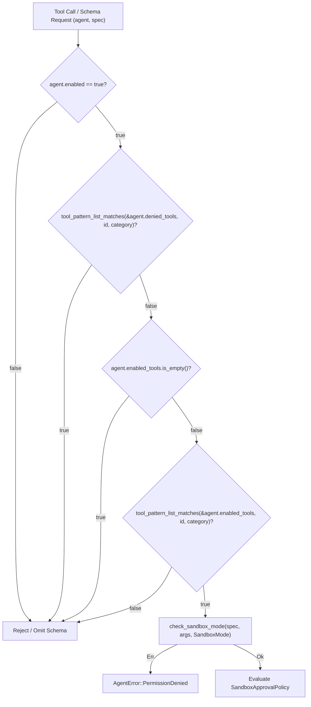

# PS5 Agent Extension & Tool Policy Model

`ps5-agent` exposes **41 built-in tools** alongside four composable file- and HTTP-backed extension mechanisms—**Custom Tools** (`tools/*.json`), **Skills** (`SKILL.md`), **Declarative Plugins** (`plugin.json`), and **Streamable-HTTP MCP Servers** (`mcp/*.json`)—plus workspace-scoped **Custom Slash Workflows** (`.agents/workflows/*.md`). All tools flow through one unified policy pipeline governing allowlists, hard denials, tool groups, canonical aliases, sandbox execution modes, and operator approval gates.

Related documentation:
- [ARCHITECTURE.md](ARCHITECTURE.md) — Workspace Brain bootstrap, runtime execution loops, virtual/host shell, stateful browser, and inbound webhooks
- [API.md](API.md) — HTTP endpoints for tools, extensions, slash commands, sandbox policies, and webhooks
- [SETTINGS_REFERENCE.md](SETTINGS_REFERENCE.md) — Full `[sandbox]`, `[tools]`, and `[security]` configuration keys

---

## 1. Extension Storage Layout & Precedence

On startup, `ToolRegistry::with_data_dir` (`crates/ps5-agent-tools/src/lib.rs`) ensures `<data_dir>/{mcp,skills,plugins,tools}` exist and pairs them with workspace `.agents/*` directories resolved from `tools.allowed_paths[0]` (falling back to `<data_dir>/workspace`):

| Mechanism | Data Directory (`<data_dir>`) | Workspace Directory (`<workspace>`) | Persistence / Override State |
|---|---|---|---|
| **Built-in Tools** | — | Sandbox operations inside `allowed_paths` | `tool_specs` SQLite/JSONL overrides (`POST/PATCH /api/v1/tools`) |
| **Custom Tools** | `<data_dir>/tools/*.json` | `<workspace>/.agents/tools/*.json` | No tool count cap; `<data_dir>` overrides or supplements workspace specs |
| **Skills** | `<data_dir>/skills/<slug>/SKILL.md` | `<workspace>/.agents/skills/<slug>/SKILL.md` | `<data_dir>/skills_state.json` (`disabled_ids`); user overrides workspace on slug collision |
| **Plugins** | `<data_dir>/plugins/<slug>/` | `<workspace>/.agents/plugins/<slug>/` | `<data_dir>/plugins_state.json` (`overrides` map) |
| **MCP Servers** | `<data_dir>/mcp/<id>.json`, `<data_dir>/mcp/*/mcp.json` | `<workspace>/.agents/mcp/*.json` | Legacy `<data_dir>/mcp_servers.json` auto-migrated; workspace configs never honor `trust_local` |
| **Custom Workflows** | — | `<workspace>/.agents/workflows/<cmd>.md` | Seeded with `daily-brief.md` via `seed_workspace_brain_files` |

---

## 2. Tool Policy Resolution & `denied_tools` Precedence

Both `AgentRuntime` (`crates/ps5-agent-runtime/src/runtime.rs`) and `ToolRegistry` (`crates/ps5-agent-tools/src/lib.rs`) enforce per-agent visibility and invocation using `agent_allows_tool_with_policy` (`crates/ps5-agent-core/src/models.rs`):



### Evaluation Order

1. **Agent Enablement**: If `!agent.enabled`, `ToolRegistry::tool_definitions_for_agent` returns `[]` and invocations fail.
2. **`denied_tools` First (Hard Deny)**: Evaluated **before** `enabled_tools`. Any match in `agent.denied_tools` unconditionally blocks the tool—even if `agent.enabled_tools` contains `"*"`, `"group:openclaw"`, `"group:*"`, or `"mcp:*"`.
3. **`enabled_tools` Allowlist**: If `agent.enabled_tools` is empty, nothing is allowed; otherwise at least one pattern must match via `tool_pattern_list_matches`.

### Supported Pattern Forms (`tool_pattern_list_matches` / `tool_pattern_matches`)

All pattern matching is ASCII case-insensitive and expands OpenClaw aliases automatically:

- **`"*"`**: Matches any tool ID (subject to `denied_tools`).
- **`"custom:*"`**: Matches either `tool_id.starts_with("custom:")` **or** `spec.category.eq_ignore_ascii_case("custom")`. Because `CustomToolManager` forbids colons in custom tool IDs (`category = "custom"` by default), `"custom:*"` is the standard way to grant or deny file-backed custom tools without listing each ID.
- **`"group:*"` & Named Groups (`group:<name>`)**: Expands via `expand_tool_group` (Section 3). `"group:*"` resolves to `"group:openclaw"`.
- **Suffix Wildcards (`"<prefix>*"`)**: Matches if the raw tool ID, canonical ID (`canonical_tool_id`), or any canonical alias (`canonical_tool_aliases`) starts with `<prefix>` (for example `"mcp:*"`, `"mcp:github:*"`, `"plugin:*"`, `"plugin:my-plugin:*"`, `"file_*"`, `"skill:*"`).
- **Exact Match**: Matches raw `tool_id`, its canonical target ID, or any canonical alias.

### Canonical Tool IDs & Legacy Aliases (`canonical_tool_id`)

| Legacy / Alias Name(s) | Canonical Tool ID | Category |
|---|---|---|
| `file_read` | `read_file` | `filesystem` |
| `file_write` | `write_file` | `filesystem` |
| `file_list` | `list_files` | `filesystem` |
| `file_mkdir`, `mkdir` | `create_directory` | `filesystem` |
| `file_delete` | `delete_file` | `filesystem` |
| `read_skill` | `load_skill` | `skills` |
| `canvas` | `write_artifact` | `utility` |
| `patch` | `apply_patch` | `filesystem` |
| `exec`, `shell`, `bash` | `sandbox_exec` | `runtime` |
| `search_files`, `grep` | `grep_search` | `filesystem` |
| `find_files`, `glob` | `glob_files` | `filesystem` |

---

## 3. OpenClaw Tool Groups (`expand_tool_group`)

`crates/ps5-agent-core/src/models.rs` implements **8 named OpenClaw groups** recognized in `enabled_tools`, `denied_tools`, and `/tools`:

| Group Name | Count | Expanded Canonical Member Tool IDs |
|---|---|---|
| `group:fs` | 9 | `read_file`, `write_file`, `edit_file`, `apply_patch`, `create_directory`, `delete_file`, `list_files`, `grep_search`, `glob_files` |
| `group:web` | 6 | `web_search`, `web_fetch`, `browser`, `http_get`, `json_api_request`, `extract_html_text` |
| `group:runtime` | 2 | `sandbox_exec`, `process` |
| `group:memory` | 6 | `memory_read`, `memory_write`, `memory_search`, `memory_get`, `read_agent_memory`, `write_agent_memory` |
| `group:sessions` | 4 | `sessions_list`, `sessions_spawn`, `sessions_send`, `session_status` |
| `group:automation` | 4 | `schedule_create`, `schedule_list`, `schedule_update`, `schedule_delete` |
| `group:utility` | 8 | `calculator`, `json_parse_format`, `timestamp_time_helper`, `text_transform_summarize_prep`, `system_info`, `ps5_info`, `doctor`, `write_artifact` |
| `group:openclaw` *(alias `group:*`)* | 39 | Union of `group:fs`, `group:web`, `group:runtime`, `group:memory`, `group:sessions`, `group:automation`, and `group:utility` |

Notes on group scope and naming:
- **Extension & A2A tools outside `group:openclaw`**:
  - A2A orchestration tools (`send_agent_message`, `assign_agent_task`, `query_agent_status`, `request_temporary_specialist`), `http_post`, `fetch_website`, and `load_skill` are granted by explicit IDs or `"*"`.
  - Dynamic extension namespaces use prefix/category wildcards (`"mcp:*"`, `"plugin:*"`, `"custom:*"`).
- **`/tools` display vs `expand_tool_group`**: `STANDARD_TOOL_GROUPS` in `crates/ps5-agent-runtime/src/slash.rs` prints summaries for 7 groups (`group:fs`, `group:web`, `group:runtime`, `group:memory`, `group:sessions`, `group:automation`, `group:openclaw`), while `expand_tool_group` also supports `group:utility` (where `system_info`, `ps5_info`, and `doctor` live). Groups such as `group:agents`, `group:system`, or `group:all` are not defined—use `"*"` for all tools or `"group:openclaw"` / `"group:*"` for the 39-tool OpenClaw core set.

---

## 4. `SandboxMode` × `SandboxApprovalPolicy` Enforcement

Once `agent_allows_tool_with_policy` passes, `AgentRuntime` and `ToolRegistry::invoke` enforce two orthogonal runtime controls:

### 4.1 Effective Mode & Policy Resolution

- **`SandboxMode`**: `agent.sandbox_mode` overrides `cfg.sandbox.mode`, defaulting to `SandboxMode::FullSandbox` (`"full_sandbox"`, alias `"full"`). Valid values: `"read_only"`, `"workspace_write"`, `"full_sandbox"`.
- **`SandboxApprovalPolicy`**: `cfg.sandbox.approval_policy` defaults to `SandboxApprovalPolicy::FullAuto` (`"full_auto"`). When `cfg.security.require_approval_for_mutating` is `true`, `FullAuto` is promoted to `OnRequest`. Valid values: `"full_auto"`, `"on_request"`, `"always_ask"`, `"never"`.
- **Builtin Classification (`is_builtin_tool_spec`)**: Any tool whose `category` is not `"custom"`, `"mcp"`, or `"plugin"` and whose ID does not start with `"custom:"`, `"mcp:"`, or `"plugin:"` is treated as built-in.

### 4.2 `SandboxMode` Restrictions (`check_sandbox_mode` / `check_runtime_sandbox_mode`)

| `SandboxMode` | Workspace / FS Tools | `sandbox_exec` | `browser` | Web / API Tools | Extensions (`mcp:*`, `plugin:*`, custom) | `doctor` |
|---|---|---|---|---|---|---|
| `read_only` | Blocks tools with `is_mutating` or `FileWrite`/`FileDelete` (`write_file`, `edit_file`, `apply_patch`, `create_directory`, `delete_file`) | Allowed (`virtual` engine rejects `>`, `>>`, `mkdir`, `touch`, `cp`, `mv`, `rm`, `sed -i`; `host` blocked) | Allows read/navigation (`open`, `navigate`, `snapshot`, `links`, `fill`, `click`, `back`, `sessions`, `close`); blocks `download`, `save_snapshot`, `submit` | Blocks `http_post` and `json_api_request` with `POST`/`PUT`/`PATCH`/`DELETE` | Blocks any tool marked `is_mutating` or carrying `FileWrite`/`FileDelete`/`WebWrite` | Allows diagnostic scan; blocks `fix=true` |
| `workspace_write` | Allowed inside workspace `allowed_paths` | `virtual` allowed (`host` also requires `allow_host_shell` + `full_sandbox`) | All browser actions allowed (subject to SSRF & challenge gates) | Blocks `http_post` and mutating `json_api_request` (`POST`/`PUT`/`PATCH`/`DELETE`) | Blocks non-built-in tools with `is_mutating == true && ToolPermission::WebWrite` (including fail-closed `mcp:*`) | Allowed |
| `full_sandbox` | Allowed inside workspace `allowed_paths` | `virtual` always allowed; `host` allowed on non-PS5 builds only if `allow_host_shell == true` | All browser actions allowed | Allowed (subject to approval/SSRF) | Allowed (subject to approval/SSRF) | Allowed |

### 4.3 `SandboxApprovalPolicy` Matrix (`evaluate_runtime_approval_policy` & `ToolRegistry::invoke`)

| `SandboxApprovalPolicy` | Built-in Read-Only (`requires_approval=false`) | Built-in Mutating (`requires_approval=true`, e.g. `http_post`, `delete_file`, `apply_patch`) | Non-Built-in with `requires_approval=true` (e.g. fail-closed `mcp:*`, mutating custom tools) |
|---|---|---|---|
| `full_auto` *(default)* | Auto-approved | Auto-approved | Interactive turns require approval; background/scheduled turns (`!persist_chat_message && !cfg.security.require_approval_for_mutating`) auto-run |
| `on_request` | Auto-approved | Interactive turns require approval; unattended non-interactive turns (`!persist_chat_message && !cfg.security.require_approval_for_mutating`) auto-run to avoid deadlocks | Interactive turns require approval; unattended non-interactive turns auto-run when `require_approval_for_mutating == false` |
| `always_ask` | Auto-approved unless `is_mutating` or `requires_approval` | Always requires operator approval (`is_mutating || requires_approval`) | Always requires operator approval (`is_mutating || requires_approval`) |
| `never` | Auto-approved | **Denied** (`PermissionDenied`) if `requires_approval == true` | **Denied** (`PermissionDenied`) if `requires_approval == true` |

*(If an explicit approval grant already occurred via pause/resume `approved_bypass = true`, the execution step bypasses re-prompting.)*

---

## 5. Fail-Closed MCP Classification & Streamable-HTTP (`McpManager`)

`crates/ps5-agent-tools/src/mcp.rs` connects exclusively to **Streamable-HTTP JSON-RPC 2.0** servers (no host stdio child-process spawning so PS5 console and host share identical behavior).

### 5.1 Configuration Precedence & Security

1. **Discovery order** (higher overwrites lower on identical server ID):
   1. `<workspace>/.agents/mcp/*.json` *(never permitted to set `trust_local = true`)*
   2. `<data_dir>/mcp_servers.json` *(legacy config automatically migrated per entry into `<data_dir>/mcp/<id>.json`)*
   3. `<data_dir>/mcp/*/mcp.json`
   4. `<data_dir>/mcp/<id>.json`
2. **File hardening**: Rejects symlinked directories/files and caps config reads at `2 MiB` (`MAX_MCP_CONFIG_FILE_BYTES`).
3. **SSRF & Transport**:
   - Server URLs are validated with `validate_mcp_url` on sync and invocation (`trust_local = true` is required to permit loopback/private LAN hosts and is stripped/disallowed on workspace `.agents/mcp/*.json` files).
   - Handshake sends `initialize` (`protocolVersion: "2025-03-26"`), `notifications/initialized`, cursor-paginated `tools/list` (`MAX_TOOLS_PAGES = 20`), and `tools/call`, retaining `Mcp-Session-Id` headers and decoding both `application/json` and `text/event-stream` SSE payloads.
   - Returned text/resource content is wrapped via `wrap_untrusted_web_content` before entering model context.

### 5.2 Fail-Closed Mutating Policy (`mcp:*`)

When `tools/list` enumerates remote tools (namespaced `mcp:<server_id>:<tool_name>`, tool names capped at `MAX_MCP_TOOL_NAME_LEN = 128`, `category = "mcp"`), `mcp.rs` inspects MCP tool annotations:

```rust
let is_mutating = item
    .get("annotations")
    .and_then(|a| a.get("readOnlyHint"))
    .and_then(|v| v.as_bool())
    != Some(true);
```

- **Fail-closed default**: Unless the server explicitly sets `"annotations": { "readOnlyHint": true }`, `McpManager` classifies the tool as:
  - `is_mutating = true`
  - `requires_approval = true`
  - `required_permissions = vec![ToolPermission::WebWrite]`
- **Explicit read-only exemption**: Only when `annotations.readOnlyHint == Some(true)` is the tool classified as non-mutating (`is_mutating = false`, `requires_approval = false`, `required_permissions = vec![ToolPermission::WebRead]`).
- **Policy impact**:
  - Agents must explicitly allow `mcp:*`, `mcp:<server_id>:*`, `"*"`, or the exact `mcp:<server_id>:<tool_name>` ID (and not match `denied_tools`).
  - Under `SandboxMode::WorkspaceWrite`, any fail-closed `mcp:*` tool (`is_mutating && WebWrite`) is blocked.
  - Under `SandboxMode::FullSandbox` + `SandboxApprovalPolicy::FullAuto`, interactive calls to fail-closed `mcp:*` tools pause for operator approval unless `readOnlyHint: true` was declared.

---

## 6. Custom Workspace Workflows (`.agents/workflows/*.md`)

Defined in `crates/ps5-agent-runtime/src/slash.rs`, workspace workflows extend `/command` handling alongside the 11 built-in slash commands (`/btw`, `/status`, `/context`, `/tools`, `/compact`, `/think`, `/model`, `/sandbox`, `/doctor`, `/new`, `/help`).

1. **Discovery & Bootstrap**:
   - `seed_workspace_brain_files` (`brain.rs`) seeds `.agents/workflows/daily-brief.md` when initializing a workspace.
   - `/help` enumerates discovered `<workspace>/.agents/workflows/*.md` slugs in `metadata.custom_workflows`.
2. **Naming & Path Hardening (`execute_custom_workflow`)**:
   - Command names must be `1..=96` characters (`MAX_WORKFLOW_NAME_LEN = 96`) matching `[a-z0-9_-]`, never `"."` or `".."`.
   - `verify_no_symlink_segment` rejects symlinks at `<workspace>`, `.agents`, `.agents/workflows`, and `<command>.md`, verifies canonical path containment within `.agents/workflows`, and enforces `MAX_WORKFLOW_BYTES = 512 KiB` UTF-8.
3. **Frontmatter & Argument Rendering**:
   - Optional YAML frontmatter supports:
     - `description`: human summary
     - `ephemeral`: boolean (defaults to `true`)
     - `mutating`: boolean (`true` forces `ephemeral = false`)
   - Arguments passed after `/<command>` substitute `{{args}}` and `$ARGUMENTS`; if neither placeholder exists and arguments are non-empty, `\n\nArguments:\n<args>` is appended (`render_workflow_body`).
4. **Execution Dispatch (`POST /api/v1/conversations/{id}/command`)**:
   - **`--show` / `--raw` flag**: Never invokes inference; returns the rendered workflow body in `content` and `metadata.executed = false`.
   - **Ephemeral workflow (`ephemeral: true`, default)**: Runs a single non-streaming `inference.generate` call with `tools: Vec::new()`, returning `ephemeral: true` and `metadata.executed = true` without appending chat history, tasks, or memory (falling back to returning rendered content with `executed: false` on `InferenceUnavailable`).
   - **Mutating workflow (`ephemeral: false` / `mutating: true`)**: Returns `ephemeral: false`, `metadata.executed = false`, and `metadata.workflow_content` so the client or caller dispatches the rendered prompt as a normal persistent conversation turn where tools can run.

---

## 7. Skills (`SKILL.md`), Declarative Plugins (`plugin.json`), and Custom Tools (`tools/*.json`)

### 7.1 Skills (`SkillManager` & `load_skill`)

- **Locations**: `<workspace>/.agents/skills/<slug>/SKILL.md` (`source = "workspace"`) and `<data_dir>/skills/<slug>/SKILL.md` (`source = "user"`, taking precedence on slug collision), plus bundled plugin skills (`source = "plugin:<plugin_id>"`).
- **Constraints (`crates/ps5-agent-tools/src/skills.rs`)**:
  - Slugs (`[a-zA-Z0-9_-]`, `<= 64` chars), symlinked skill directories or `SKILL.md` files rejected, markdown capped at `512 KiB` (`MAX_SKILL_MARKDOWN_BYTES`).
  - Resource subdirectories (`scripts`, `references`, `examples`, `resources`) scanned up to depth `4` and `256` files.
  - Enable/disable overrides persisted in `<data_dir>/skills_state.json`.
- **Runtime Integration**:
  - `AgentRuntime::build_system_prompt` injects up to `24` enabled skill `(name, description)` entries when the agent is permitted `load_skill` (`alias: read_skill`).
  - Calling `load_skill` invokes `load_skill_across_managers`, searching `SkillManager` first and `PluginManager::enabled_bundled_skills()` second.

### 7.2 Declarative Plugins (`PluginManager`)

- **Locations (`crates/ps5-agent-tools/src/plugins.rs`)**: `<workspace>/.agents/plugins/<slug>/` and `<data_dir>/plugins/<slug>/`, loading either `plugin.json` or `.claude-plugin/plugin.json` (`MAX_PLUGIN_MANIFEST_BYTES = 2 MiB`; symlinked components skipped; toggle state persisted in `<data_dir>/plugins_state.json`).
- **Four Composable Bundle Surfaces**:
  1. **System Prompt Rules (`rules`)**: Markdown guidelines (each capped at `MAX_PLUGIN_RULE_BYTES = 512 KiB`) returned by `PluginManager::enabled_rules()` and injected into prompts (`Active Plugin Guidelines`, capped at `24` rules).
  2. **Bundled Skills (`skills/*/SKILL.md`)**: Loaded transparently by `load_skill` when the plugin is enabled.
  3. **Declarative Tools (`tools[]`)**: Registered into `ToolRegistry` as `plugin:<plugin_id>:<tool_name>` (`category = "plugin"`). Supports `"template"` (`{{param}}` substitution) and `"http"` (`validate_web_url` SSRF validation, `MAX_PLUGIN_HTTP_REDIRECTS = 5`, `DEFAULT_PLUGIN_TOOL_TIMEOUT_SECS = 30`, sensitive-header redirect stripping, CR/LF header guard, masked header views, optional `is_mutating` flag).
  4. **Bundled MCP Servers (`mcpServers` / `mcp_config.json` / `.mcp.json`)**: Automatically imported into `McpManager` during `startup.rs` (`sync_plugin_mcp_configs`).

### 7.3 File-Backed Custom Tools (`CustomToolManager`)

- **Locations (`crates/ps5-agent-tools/src/custom.rs`)**: `<workspace>/.agents/tools/*.json` and `<data_dir>/tools/*.json`, with **no fixed count cap** (unlimited custom tools).
- **ID Validation & Collision Protection (`validate_custom_tool_id`)**:
  - IDs must be `1..=96` chars (`MAX_CUSTOM_TOOL_ID_LEN = 96`) matching `[a-zA-Z0-9_.-]`, forbidding `..`, leading/trailing `.`, `:`, built-in tool ID collisions, and reserved prefixes `mcp:`, `plugin:`, `custom:`.
  - Manifests are bounded to `2 MiB` (`MAX_CUSTOM_TOOL_FILE_BYTES`); parsed via single object, array, `{"tools":[...]}`, or OpenAI `{"type":"function","function":{...}}` formats (`POST /api/v1/tools` persists to `<data_dir>/tools/<sanitized_id>.json`).
- **Execution & Policy Binding**:
  - Supports `"template"` and `"http"` (`MAX_CUSTOM_HTTP_REDIRECTS = 5`, `DEFAULT_CUSTOM_TOOL_TIMEOUT_SECS = 20`, `validate_web_url` SSRF checks with optional `allow_private_lan`, bounded response bytes).
  - Converted to `ToolSpec` with default `category = "custom"` (so `"custom:*"` matches it in agent policies), `requires_approval`, `is_mutating`, and inferred or explicit `required_permissions` (`WebRead`/`WebWrite` for `http`, `Utility` for `template`). Thus custom tools obey every `SandboxMode`, `SandboxApprovalPolicy`, and `denied_tools`/`enabled_tools` rule identically to built-in tools.
